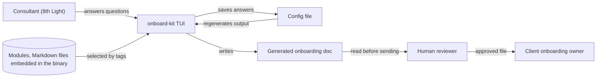

# Context

Status: proposed

Who and what touches onboard-kit. The tool is internal. The client receives only the generated file.

> [!NOTE]
> **What is a module?**
>
> A module is one Markdown file holding a single piece of onboarding content, such as the first week plan or the access checklist. Each module carries frontmatter that says when to include it and which placeholders it needs. The tool selects modules from the walkthrough answers and merges them into one document. Modules are plain Markdown, so people and agents can write them without special tooling. The frontmatter shape is an open decision, see [05-module-schema.md](05-module-schema.md).

## Notes

- Modules ship inside the binary, so every consultant on the same version gets the same content.
- The config file and the generated doc contain client specifics. Both are written under `output/`, which git ignores.
- A human reviews every document before it leaves 8th Light. The tool reminds the consultant but cannot enforce it.
- The client never runs the tool. They get a file in the format the consultant chose.

## Open questions

- Who reviews, and what do they check? See [#12](https://github.com/8thlight-daveloper/onboard-kit/issues/12).
- If we host a web version, this picture changes. See [#4](https://github.com/8thlight-daveloper/onboard-kit/issues/4).
