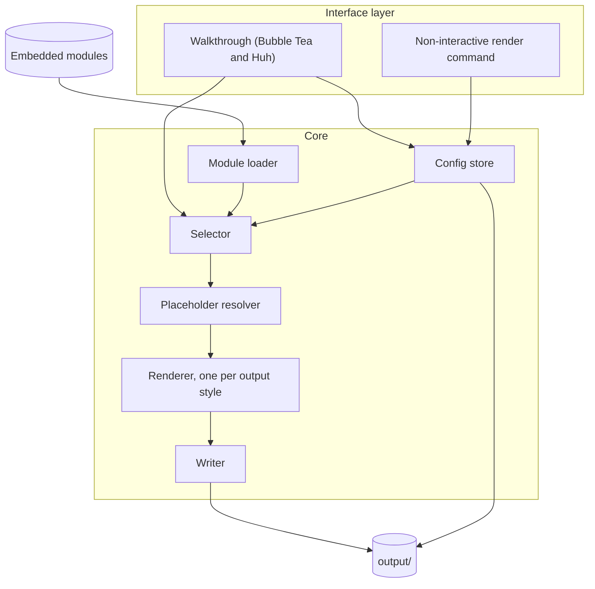

# Components

Status: proposed

The tool splits into a thin interface layer and a core that knows nothing about terminals. Dependencies point one way, from the interface layer into the core.

## Responsibilities

| Component | Does |
| --- | --- |
| Walkthrough | Asks questions, shows the review screen, ends with the human review reminder |
| Non-interactive render command | Reads a saved config and renders without asking anything |
| Config store | Reads and writes the config file, checks schema and module set versions |
| Module loader | Reads embedded modules and parses frontmatter |
| Selector | Picks and orders modules from tags in the answers |
| Placeholder resolver | Fills values, marks unknown values with a visible to-do |
| Renderer | Turns the resolved modules into one document for a chosen output style |
| Writer | Writes the document and config under `output/` |

## Dependency rules

These are candidates for architecture tests, see [#20](https://github.com/8thlight-daveloper/onboard-kit/issues/20).

- The interface layer may import core. Core never imports the interface layer.
- Renderers do not know about each other. Adding a style adds one package.
- Only the writer touches the filesystem outside embedded modules.
- Only the config store reads or writes config files.

## Open questions

- Is the placeholder resolver separate from the renderer, or does the renderer fill values as it goes? Depends on [#3](https://github.com/8thlight-daveloper/onboard-kit/issues/3).
- Are output styles render-time transforms or per-style module variants? See [#8](https://github.com/8thlight-daveloper/onboard-kit/issues/8).
