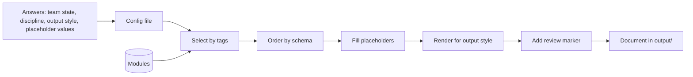

# Data flow

Status: proposed

How modules and answers become a document. Every step is deterministic.

## Properties

- **Repeatable.** Same config and same module set give byte-identical output. Tests can assert this.
- **Regenerable.** Edit the config or update the module set, run again, and get a new document. No re-asking.
- **Several styles from one config.** Change only the output style to produce another format.
- **Visible gaps.** A placeholder marked "unknown yet" renders as a to-do the reviewer cannot miss.
- **Review marker.** Output carries a marker until a person removes it.

## What the config holds

| Field | Purpose |
| --- | --- |
| Team state | Established team or first consultants |
| Discipline | Software or design |
| Output style | Target such as Google Doc, GitHub, GitLab |
| Placeholder values | Organization specifics, entered once |
| Optional modules | Which are on or off |
| Versions | Schema version and module set version it was made with |

## Open questions

- Format: YAML, TOML, or JSON. See [#23](https://github.com/8thlight-daveloper/onboard-kit/issues/23).
- What happens when a config was made with an older module set? Show a diff, or refuse and ask.
- Secrets. The resolver rejects values that look like tokens, and the same check applies to config files.
