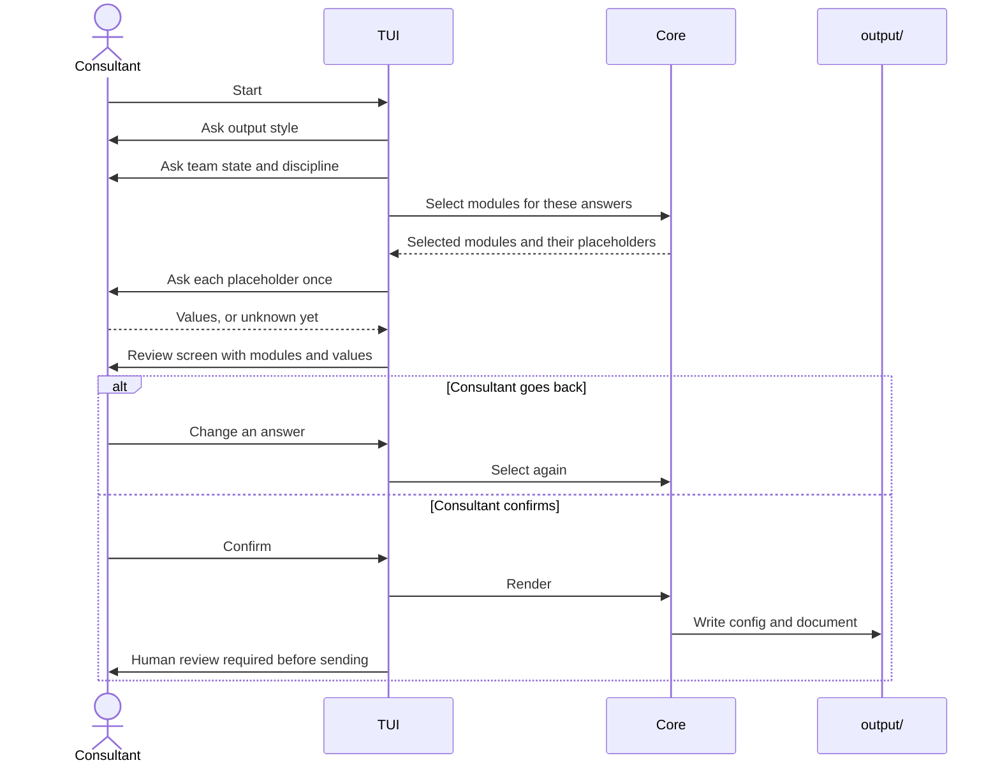
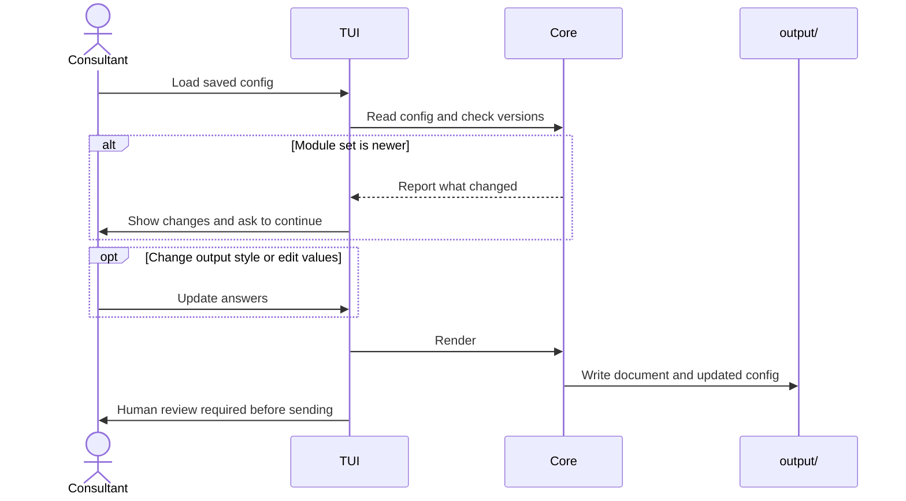

# Walkthrough sequence

Status: proposed

One run of the TUI, first from scratch and then regenerating from a saved config.

## New run

## Regenerate

## Notes

- The consultant can back out at the review screen without writing anything.
- The non-interactive render command takes the same path as regeneration, with no questions.
- The reminder about human review appears on every run that writes a document.

## Open questions

- Can the consultant edit the config by hand and skip the TUI entirely? Probably yes, which makes the format matter. See [#23](https://github.com/8thlight-daveloper/onboard-kit/issues/23).
- Which questions are optional and which gate the rest? See [#6](https://github.com/8thlight-daveloper/onboard-kit/issues/6).
