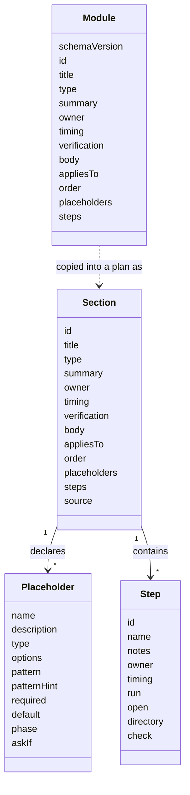

# Module schema

Status: proposed. Field names are not final, see [#3](https://github.com/8thlight-daveloper/onboard-kit/issues/3). A worked example lives in [examples/acme](examples/acme/README.md).

A module is one YAML file at `modules/<id>.yaml`. A plan holds every standard module as a section, copied unchanged with one added field, `source`. So a module and a section have the same shape, and a module file is a section before it is in a plan. The fields the selector needs, `appliesTo` and `order`, stay in the section. Which sections are active is computed from the plan's answers whenever it is needed, and placeholders stay in place until the document is assembled. See [0030](../decisions/0030-self-contained-plan-file.md).



## Selection and question fields

| Field | Purpose |
| --- | --- |
| `appliesTo` | Axis values the section applies to, such as team states and disciplines. `any` matches every value |
| `order` | Sort position. Ties break on `id`, so output stays deterministic |
| `placeholders` | Values the section needs, each with a name, a description, an optional type, and optional `required` and `default`. Each becomes a question |
| `source` | Plan only. The module id and a content hash recorded when the module was copied. See 0030 |
| `schemaVersion` | Module files only. Plans carry one at the top |

## Steps

Steps are plain YAML with a vocabulary borrowed from CI files.

| Field | Meaning |
| --- | --- |
| `id`, `name` | Stable identifier and display name |
| `notes` | Optional Markdown prose |
| `owner`, `timing` | Who acts and when. A step inherits `timing` from its module |
| `run` | Command as an argument list, no shell |
| `open` | A URL or file to open |
| `directory` | Directory to run `run` in |
| `check` | Verification, either `run` (a command) or `ask` (a yes or no question) |

A step with `run` and no `check` passes when the command exits with code 0. Steps are optional. The MVP renders them as a checklist. A later walkthrough runtime acts on them, under the trust rules in [#29](https://github.com/8thlight-daveloper/onboard-kit/issues/29).

## Placeholders

- Syntax is `$name`. Names match `[a-z][a-z0-9_]*` and end at the first other character. Write `$$` for a literal dollar sign.
- `$name` parses as a plain string in both YAML flow and block context, and it shows in GitHub's Markdown preview. The other delimiters we tried either fail to parse or load wrong data silently. `{{ name }}` becomes a nested mapping if left unquoted.
- A value of `unknown-yet` renders as a visible gap with an owner and timing. It is accepted for every type, as its own entry and not as free text.
- Each section's placeholder is its own question, with its own description, type, and default. Values are per section. See [0030](../decisions/0030-self-contained-plan-file.md).

### Fields

| Field | Meaning |
| --- | --- |
| `name` | The `$name` the section uses |
| `description` | What the question asks, in words |
| `type` | `string` (the default), `boolean`, `choice`, or `command` |
| `options` | The allowed values of a `choice` |
| `pattern` | A regular expression a `string` must match |
| `patternHint` | The expected format in words, shown when a value does not match |
| `required` | Whether the question must have a value. Defaults to false |
| `default` | The value used when none is given. It must satisfy the type, options, and pattern |
| `phase` | `planning` (the default) or `onboarding`. See below |
| `askIf` | A question condition: ask this question only when other answers match. See below |

### Types

| Type | Allowed entries | Free entry |
| --- | --- | --- |
| `string` | Any text, checked against `pattern` if there is one | Yes |
| `boolean` | `true` or `false`, lowercase | No |
| `choice` | One of `options` | No |
| `command` | An argument list. It expands as a list inside `run`, and joins with spaces in prose | Yes, as a list |

- `pattern` uses RE2 syntax, a portable subset with no backreferences or lookaround, so every language can run it.
- A URL check belongs in `pattern`. A clone address such as `git@host:org/repo.git` is not a standard URL, so a built-in `url` type would reject it. The secrets check also looks inside a URL for an embedded credential.

### Question conditions

A question condition says "ask this question only if other answers match." It gates one question, which is one placeholder. Sections have their own gates: `appliesTo`, and an `enabled` placeholder, see [Optional sections](#optional-sections).

```yaml
placeholders:
  - name: staging_url
    description: Staging URL
    askIf:
      all:
        - question: plan.discipline
          answer:
            is: software
        - question: plan.teamState
          answer:
            isNot: first-consultants
        - question: repo_url
          answer:
            isAnswered: true
```

A condition is data, not an expression string. Every implementation language reads it the same way, the JSON Schema checks it, and it can grow without breaking old plans.

| Part | Meaning |
| --- | --- |
| `all` | A list of clauses that must all be true. It is the only combinator for now. Add `any` when a real module needs it |
| `question` | The id of the question to test. A bare name is a question in the same section. `plan.<name>` is a plan-level question |
| `answer` | The tests on that question's answer. Several tests in one `answer` must all hold |

Answer tests:

| Test | True when |
| --- | --- |
| `is` | The answer is this one value |
| `isNot` | The answer is a real value other than this one |
| `isOneOf` | The answer is one of these values, a list of two or more |
| `isNotOneOf` | The answer is a real value that is none of these, a list of two or more |
| `isAnswered` | `true`: the question has a real value. `false`: it has none |

Rules:

- **More combinators later.** `any` and `none` are not supported yet. Add them together when a real module needs one, with a rule that a condition on an unanswered question is never true, so `none` cannot ask early.
- **Real value.** The question is active and the plan stores a value for it that is not `unknown-yet` and not empty. A boolean `false` is a real value. A declared `default` is not stored until a person selects it, so it does not count.
- **Unanswered means false.** Every test except `isAnswered` is false when the question has no real value, before any negation. So `isNot` on an unanswered question is false, and the follow-up is not asked early.
- **When false.** The question is not active. It keeps its stored value, is not asked, and does not block.
- **Values fit the question.** Tested values must satisfy the type and options of the question they test.
- **Validator problems.** A reference to an unknown question, and a cycle of conditions.
- **Lint errors.** A condition that cannot do its job:
  - `isOneOf` or `isNotOneOf` with a single value. Use `is` or `isNot`.
  - A list test on a `boolean`. Use `is`, or `isAnswered` for both values.
  - A list test that names every option of a `choice`. Use `isAnswered`.
  - Tests that can never hold together, such as `is: a` with `isNot: a`.

### Phase

`phase` says which process asks the question.

- **`planning`** is asked while the consultant builds the plan, and the value is stored in the plan.
- **`onboarding`** is asked of each newcomer while they onboard. The plan does not hold the value, because each person has their own. Planning skips it: it is not asked and does not block. The assembled document shows it as a blank, `<name>`. Storing and asking for these values waits for the onboarding runtime, [#28](https://github.com/8thlight-daveloper/onboard-kit/issues/28).

## Optional sections

A section that can be switched off declares a placeholder named `enabled`. It is an ordinary placeholder, so it has a `description`, `required`, `default`, and the rest.

```yaml
placeholders:
  - name: enabled
    description: Include the design review?
    type: boolean
    default: true
```

- **A section with no `enabled` placeholder is always on** when its `appliesTo` matches. Nobody is asked.
- **The question** has the id `<section>.enabled`. The finder returns it before that section's other questions, in section `order`. The answer is stored in `values.sections.<id>.enabled`.
- **When the answer is false**, the section's other questions are inactive. They keep their stored values, are not asked, and do not block.
- **No answer.** The `default` applies. With neither an answer nor a default, the section is off. A `required` toggle with no answer is a blocker.
- **Restrictions.** `enabled` must be `boolean`. `unknown-yet` is not accepted for it, because a section is either in or out. `askIf` is not supported on it yet.
- **Conditions can test it.** A clause can name `<section>.enabled` like any other question.

## Reserved names

Placeholder names match `[a-z][a-z0-9_]*`. Lint rejects the names below. The validator rejects them in a plan too.

| Reserved | Why |
| --- | --- |
| `enabled` | Reserved for the toggle above. It cannot be used as `$enabled` in text |
| `yes`, `no`, `y`, `n`, `true`, `false`, `on`, `off`, `null` | YAML can read these as booleans or null. As keys in `values` they would load as the wrong data, and 0030 rejects them |

Module ids are reserved too. A module id is a lowercase slug, and lint rejects `plan` and the YAML words above as ids. `plan` is the scope of plan-level answers, so a section named `plan` would make ids like `plan.teamState` ambiguous.

Names are reserved only where a real clash exists. Words such as `default` and `type` are not reserved, because a placeholder name appears as a value of `name:`, never as a field key. Adding a reserved name later can break existing modules, so each new one needs a schema version bump and a lint message that says what to rename.

## Format rules

- Prose fields, `body` and `notes`, hold Markdown in literal blocks, hard-wrapped.
- One JSON Schema covers modules and plans, so editors can validate and complete them.
- Modules decode strictly and reject unknown fields. Plans decode leniently and keep unknown fields, so a plan written by a newer tool survives an older one.
- Everything beyond `id`, `title`, `type`, and `summary` is optional, so the schema can grow without breaking older files.
- Booleans are lowercase `true` and `false` only. Unquoted `yes`, `no`, `on`, `off`, and similar are errors, and so are anchors and aliases. See the Format section of 0030.

## Selection

- A section is active when its `appliesTo` matches the plan's axis values and its `enabled` answer, or default, is true. A section with no `enabled` placeholder is always on.
- Active sections sort by `order`.
- Core modules carry `any` for both axes. Variants narrow one axis.

## Open questions

- How does a variant override or extend a core module?
- Are module dependencies needed, or does ordering cover it?
- Does a `reviewedOn` date drive a staleness warning?
- Do we borrow `if:` from CI files for per-platform commands?
