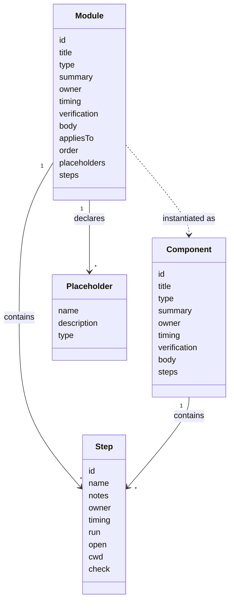

# Module schema

Status: proposed. Field names are not final, see [#3](https://github.com/8thlight-daveloper/onboard-kit/issues/3). A worked example lives in [examples/acme](examples/acme/README.md).

A module is one YAML file at `modules/<id>.yaml`. It carries the content of a plan component, plus the fields the selector needs. Instantiation selects modules, orders them, fills placeholders, and drops the selection fields. What remains is a component in the plan.

## Fields that exist only in modules

| Field | Purpose |
| --- | --- |
| `appliesTo` | Team states and disciplines the module applies to. `any` matches every value |
| `order` | Sort position. Ties break on `id`, so output stays deterministic |
| `placeholders` | Values the module needs, each with a name, a description, and an optional type |

## Steps

Steps are plain YAML with a vocabulary borrowed from CI files.

| Field | Meaning |
| --- | --- |
| `id`, `name` | Stable identifier and display name |
| `notes` | Optional Markdown prose |
| `owner`, `timing` | Who acts and when. A step inherits `timing` from its module |
| `run` | Command as an argument list, no shell |
| `open` | A URL or file to open |
| `cwd` | Working directory for `run` |
| `check` | Verification, either `run` (a command) or `ask` (a yes or no question) |

A step with `run` and no `check` passes when the command exits with code 0. Steps are optional. The MVP renders them as a checklist. A later walkthrough runtime acts on them, under the trust rules in [#29](https://github.com/8thlight-daveloper/onboard-kit/issues/29).

## Placeholders

- Syntax is `$name`. Names match `[a-z][a-z0-9_]*` and end at the first other character. Write `$$` for a literal dollar sign.
- `$name` parses as a plain string in both YAML flow and block context, and it shows in GitHub's Markdown preview. The other delimiters we tried either fail to parse or load wrong data silently. `{{ name }}` becomes a nested mapping if left unquoted.
- A placeholder of `type: command` holds an argument list. It expands as a list inside `run`, and joins with spaces in prose.
- A value of `unknown-yet` renders as a visible gap with an owner and timing.

## Format rules

- Prose fields, `body` and `notes`, hold Markdown in literal blocks, hard-wrapped.
- One JSON Schema covers modules and plans, so editors can validate and complete them.
- Modules decode strictly and reject unknown fields. Plans decode leniently and keep unknown fields, so a plan written by a newer tool survives an older one.
- Everything beyond `id`, `title`, `type`, and `summary` is optional, so the schema can grow without breaking older files.

## Selection

- A module is included when its `appliesTo` matches the answers.
- Included modules sort by `order`.
- Core modules carry `any` for both axes. Variants narrow one axis.

## Open questions

- Which placeholder types do we need beyond string and command?
- How does a variant override or extend a core module?
- Are module dependencies needed, or does ordering cover it?
- Does a `reviewedOn` date drive a staleness warning?
- Do we borrow `if:` from CI files for per-platform commands?
