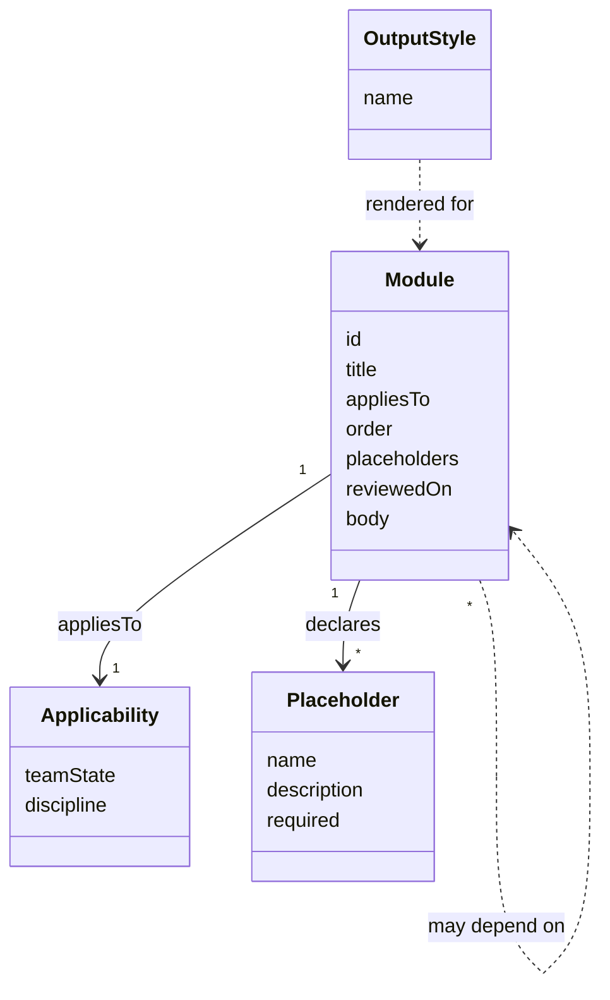

# Module schema

Status: proposed. The schema is still an open decision, see [#3](https://github.com/8thlight-daveloper/onboard-kit/issues/3).

A module is one Markdown file with frontmatter. The frontmatter tells the selector when to include it, where it goes, and which values it needs.



## Example frontmatter

```yaml
id: first-week
title: First week
appliesTo:
  teamState: [established, first-consultants]
  discipline: [any]
order: 20
placeholders:
  - name: onboarding_owner_role
    description: Role of the person who owns onboarding at the organization
    required: true
reviewedOn: 2026-10-14
```

Field names and syntax are examples, not decisions.

## Selection

- A module is included when its `appliesTo` matches the answers. `any` matches every value.
- Included modules sort by `order`, with ties broken by `id` so output stays deterministic.
- Core modules carry `any` for both axes. Variants narrow one axis.

## Constraints the schema must meet

- Placeholder syntax survives the formatter unchanged.
- The linter can detect undeclared and unused placeholders.
- A new variant or discipline is one new file, with no code changes.
- Output styles apply at render time or as per-style variants. That choice is part of [#8](https://github.com/8thlight-daveloper/onboard-kit/issues/8).

## Open questions

- How does a variant override or extend a core module?
- Are module dependencies needed, or does ordering cover it?
- Does `reviewedOn` drive a staleness warning?
