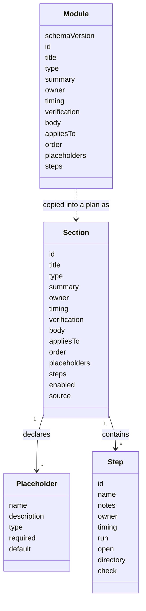

# Module schema

Status: proposed. Field names are not final, see [#3](https://github.com/8thlight-daveloper/onboard-kit/issues/3). A worked example lives in [examples/acme](examples/acme/README.md).

A module is one YAML file at `modules/<id>.yaml`. A plan holds every standard module as a section, copied unchanged with one added field, `source`. So a module and a section have the same shape, and a module file is a section before it is in a plan. The fields the selector needs, `appliesTo` and `order`, stay in the section. Which sections are active is computed from the plan's answers whenever it is needed, and placeholders stay in place until the document is assembled. See [0030](../decisions/0030-self-contained-plan-file.md).

## Selection and question fields

| Field | Purpose |
| --- | --- |
| `appliesTo` | Axis values the section applies to, such as team states and disciplines. `any` matches every value |
| `order` | Sort position. Ties break on `id`, so output stays deterministic |
| `placeholders` | Values the section needs, each with a name, a description, an optional type, and optional `required` and `default`. Each becomes a question |
| `enabled` | Plan only. Whether an optional section is on. Starts from the module's default |
| `source` | Plan only. The module id and a content hash recorded when the module was copied. See 0030 |
| `schemaVersion` | Module files only. Plans carry one at the top |

## Steps

Steps are plain YAML with a vocabulary borrowed from CI files.

| Field | Meaning |
| --- | --- |
| `id`, `name` | Stable identifier and display name |
| `notes` | Optional Markdown prose |
| `owner`, `timing` | Who acts and when. A step inherits `timing` from its module |
| `run` | Command as an argument list, no shell |
| `open` | A URL or file to open |
| `directory` | Directory to run `run` in |
| `check` | Verification, either `run` (a command) or `ask` (a yes or no question) |

A step with `run` and no `check` passes when the command exits with code 0. Steps are optional. The MVP renders them as a checklist. A later walkthrough runtime acts on them, under the trust rules in [#29](https://github.com/8thlight-daveloper/onboard-kit/issues/29).

## Placeholders

- Syntax is `$name`. Names match `[a-z][a-z0-9_]*` and end at the first other character. Write `$$` for a literal dollar sign.
- `$name` parses as a plain string in both YAML flow and block context, and it shows in GitHub's Markdown preview. The other delimiters we tried either fail to parse or load wrong data silently. `{{ name }}` becomes a nested mapping if left unquoted.
- A placeholder of `type: command` holds an argument list. It expands as a list inside `run`, and joins with spaces in prose.
- A value of `unknown-yet` renders as a visible gap with an owner and timing.

## Format rules

- Prose fields, `body` and `notes`, hold Markdown in literal blocks, hard-wrapped.
- One JSON Schema covers modules and plans, so editors can validate and complete them.
- Modules decode strictly and reject unknown fields. Plans decode leniently and keep unknown fields, so a plan written by a newer tool survives an older one.
- Everything beyond `id`, `title`, `type`, and `summary` is optional, so the schema can grow without breaking older files.
- Booleans are lowercase `true` and `false` only. Unquoted `yes`, `no`, `on`, `off`, and similar are errors, and so are anchors and aliases. See the Format section of 0030.

## Selection

- A section is active when its `appliesTo` matches the plan's axis values and it is enabled.
- Active sections sort by `order`.
- Core modules carry `any` for both axes. Variants narrow one axis.

## Open questions

- Which placeholder types do we need beyond string and command?
- How does a variant override or extend a core module?
- Are module dependencies needed, or does ordering cover it?
- Does a `reviewedOn` date drive a staleness warning?
- Do we borrow `if:` from CI files for per-platform commands?
- Where several active sections declare the same placeholder, which description, `required`, and default does the question take?
- How is the condition for asking a question written?
