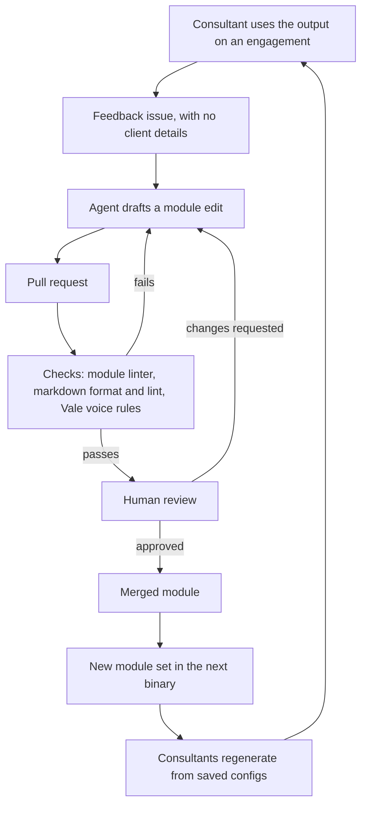

# Authoring loop

Status: proposed

How feedback becomes a better module. Agents help draft changes. People decide what ships.

## Rules

- Agents write and tune modules. They never run the walkthrough or touch client output.
- Every agent-authored change goes through a pull request and human review.
- Checks run before review, so reviewers read changes that already pass mechanical rules.
- Feedback arrives stripped of client details. The issue template reminds the author.
- Agentic evaluation of module quality is out of scope. Consultant feedback is the signal.

## What each check covers

| Check | Catches |
| --- | --- |
| Module linter | Undeclared placeholders, missing frontmatter, client names, URLs, broken links |
| Markdown format and lint | Structure and GitHub Flavored Markdown formatting |
| Vale | Voice rules such as no em dashes and no banned filler words |

## Open questions

- When do we prompt consultants for feedback, for example at the 30 and 90 day marks? See [#11](https://github.com/8thlight-daveloper/onboard-kit/issues/11).
- How do we release module updates to consultants? Depends on hosting and distribution, see [#4](https://github.com/8thlight-daveloper/onboard-kit/issues/4).
- What may an agent change without a person asking for it? See [#10](https://github.com/8thlight-daveloper/onboard-kit/issues/10).
