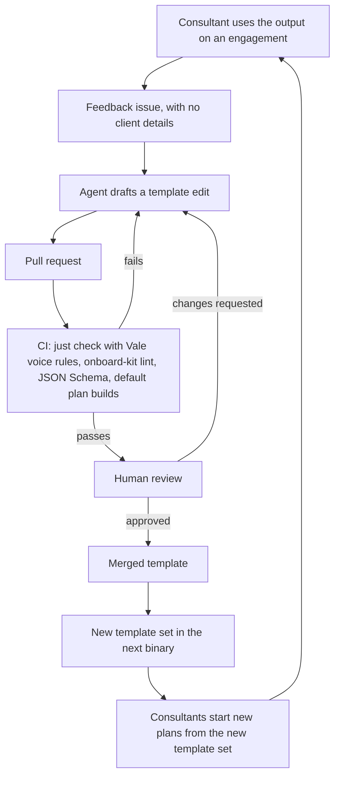

# Authoring loop

Status: accepted

How feedback becomes a better template. Agents help draft changes. People decide what ships.

## Rules

- Agents write and tune templates. They never run the walkthrough or touch client output.
- Every agent-authored change goes through a pull request and human review.
- Checks run before review, so reviewers read changes that already pass mechanical rules.
- Feedback arrives stripped of client details. The issue template reminds the author.
- Agentic evaluation of template quality is out of scope. Consultant feedback is the signal.

## What each check covers

| Check | Catches | Runs |
| -- | -- | -- |
| Section validator | Undeclared or unused variables, defaults that do not fit, reserved names, bad condition references and cycles, missing required fields, format rules from 0030 | `onboard-kit lint` |
| Template linter | Client names, URLs, email addresses, and broken links | `onboard-kit lint` |
| Voice rules | No em dashes, no banned filler words, no chatbot openers, no announced importance, sentence case headings. Applies to Markdown and to prose inside template YAML | Vale, in `just check` |
| Schema validation | Template files that do not match the JSON Schema | CI, and in editors |
| Default plan build | A template set from which the plan instantiator cannot build a default plan | The acceptance suite on the real templates |

CI runs `onboard-kit lint` on every pull request that changes anything under `templates/`, and fails on any finding. Templates ship inside the binary, so a template that fails here must not reach a release.

Voice rules live in one place, the Vale style files under `.vale/`. Vale reads YAML as text, so the same rules cover prose inside templates, and CI runs them through `just check`. The template linter does not repeat them. `mdformat` and `markdownlint` apply to Markdown only. See [dev tooling](../stack/dev-tooling.md).

## Existing plans

A plan is self-contained, so a new template set reaches it only through the update action, which is deferred until after the MVP. Each section's recorded source and hash will tell the update what a person edited and what changed upstream. See [0030](../decisions/0030-self-contained-plan-file.md).

## Open questions

- When do we prompt consultants for feedback, for example at the 30 and 90 day marks?
- How do we release template updates to consultants? Depends on hosting and distribution.
- What may an agent change without a person asking for it?
