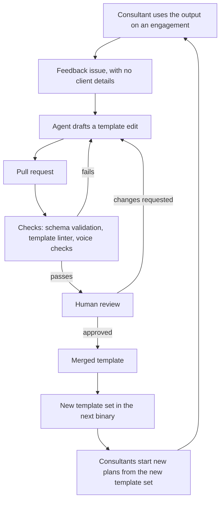

# Authoring loop

Status: accepted

How feedback becomes a better template. Agents help draft changes. People decide what ships.

## Rules

- Agents write and tune templates. They never run the walkthrough or touch client output.
- Every agent-authored change goes through a pull request and human review.
- Checks run before review, so reviewers read changes that already pass mechanical rules.
- Feedback arrives stripped of client details. The issue template reminds the author.
- Agentic evaluation of template quality is out of scope. Consultant feedback is the signal.

## What each check covers

| Check | Catches |
| --- | --- |
| Template linter | Undeclared placeholders, missing required fields, unquoted `yes` or `no` and other format rules from 0030, client names, URLs, broken links |
| Schema validation | Template files that do not match the JSON Schema |
| Voice checks | Rules such as no em dashes and no banned filler words, run on prose fields |

Format and lint tools for Markdown apply to the repo's own docs. They do not reach prose inside template YAML, so voice checks for templates run in `onboard-kit lint`. Whether Vale can lint prose inside YAML is still to check.

## Existing plans

A plan is self-contained, so a new template set reaches it only through the update action, which is deferred until after the MVP. Each section's recorded source and hash will tell the update what a person edited and what changed upstream. See [0030](../decisions/0030-self-contained-plan-file.md).

## Open questions

- When do we prompt consultants for feedback, for example at the 30 and 90 day marks? See [#11](https://github.com/8thlight-daveloper/onboard-kit/issues/11).
- How do we release template updates to consultants? Depends on hosting and distribution, see [#4](https://github.com/8thlight-daveloper/onboard-kit/issues/4).
- What may an agent change without a person asking for it? See [#10](https://github.com/8thlight-daveloper/onboard-kit/issues/10).
