# Components

Status: accepted

The parts of the tool, and which may depend on which. Each component has one responsibility and can be deleted and rebuilt from its contract. The rules and the full responsibilities are in [0020](../decisions/0020-binary-structure-and-regenerative-components.md). Terms are in the [glossary](../glossary.md).

Arrows point from a component to what it depends on, including planned
dependencies. The responsibility tables identify pending work. Every component
also depends on the domain model, which is left out of the diagram.

```mermaid
flowchart TB
    subgraph drivers["Drivers"]
        tui["TUI walkthrough"]
        stdio["stdio command, for tests"]
        assemble_command["assemble command"]
        lint_command["lint command"]
    end

    entry["Entry point, binary/"]

    subgraph core["Core components"]
        finder["Question finder"]
        validator["Plan validator"]
        structurevalidator["Plan structure validator"]
        editor["Plan editor"]
        assembler["Document assembler"]
        instantiator["Plan instantiator"]
        refresher["Plan refresher"]
        migrator["Plan migrator"]
        decoder["Plan decoder"]
        encoder["Plan encoder"]
        recorddecoder["Record decoder"]
        recordencoder["Record encoder"]
        joiner["Record joiner"]
        splitter["Record splitter"]
        reconciler["Record reconciler"]
        loader["Section loader"]
        selector["Section selector"]
        scheduler["Section scheduler"]
        evaluator["Condition evaluator"]
        resolver["Section resolver"]
        hasher["Section hasher"]
        sectionvalidator["Section validator"]
        linter["Template linter"]
        secrets["Secrets check"]
    end

    templates[("Embedded templates")]
    planfile[("Plan file")]
    document[("Document in output/")]

    tui --> finder
    tui --> editor
    tui --> assembler
    stdio --> finder
    stdio --> editor
    assemble_command --> assembler
    lint_command --> loader
    lint_command --> sectionvalidator
    lint_command --> linter

    finder --> selector
    finder --> evaluator
    selector --> evaluator
    scheduler --> structurevalidator
    scheduler --> selector
    validator --> structurevalidator
    validator --> finder
    validator --> sectionvalidator
    validator --> secrets
    editor --> finder
    editor --> validator
    assembler --> selector
    assembler --> scheduler
    assembler --> resolver
    instantiator --> hasher
    reconciler --> hasher

    entry --> loader
    entry --> instantiator

    templates --> loader
    planfile --> decoder
    decoder --> migrator
    tui --> decoder
    tui --> encoder
    entry --> document
    entry --> planfile
```

## Responsibilities

| Component | Does |
| -- | -- |
| Plan authoring validator | Checks whole-plan declaration and reference semantics, including actual default/environment secret checks. Combined with the existing plan validator at the new start boundary, not a replacement for answer/structure validation. See [0370](../decisions/0370-plan-authoring-validation.md) |
| Question finder | Finds a plan's active questions, one per section variable plus with their answers, groups, and suggestions, evaluates question conditions, and the required ones with no value. Reads only |
| Plan validator | Checks answers, directory integrity, local variable/step/team identities, and all stored answers for secrets. Delegates complete declared section relationships to the real plan structure validator before applicability filtering; merges independent diagnostics without a global short circuit. CheckValue remains local. Condition-reference legality and section-template validation remain pending |
| Plan structure validator | Reports duplicate section identities, invalid Parent/Requires/After references, true graph cycles, impossible combined ordering, and contradictory bootstrap claims. Checks complete declarations before activity filtering; returns problems only |
| Section validator | Checks one section's own structure, whether it is a template or a section in a plan: variables declared and used, defaults that fit their type and pattern, reserved names, references within the section, the `$` rule, check shapes, and `escalation` references, with warnings for thin contacts and single points of failure. Lint rules for conditions, such as a one-entry `isOneOf`, live here |
| Template linter | Checks the hygiene of template text against a rules file: client names, URLs, email addresses, and broken links. Takes parsed templates, returns findings. Voice rules are not here. Vale checks them, see [dev tooling](../stack/dev-tooling.md) |
| Plan editor | Returns a copy of a plan with one answer applied, one section's switch changed, or one directory entry added, changed, or removed. An answer changes only `answers`, a switch only that section's `enabled`, and a directory edit only the directory. Removing an entry also clears the answers and holder entries that named it, and reports them. The plan it was given is not altered |
| Document assembler | Renders ordinary grouped reference documents with explicit prerequisites, gap table and review marker. Its bootstrap operation validates and schedules the full original plan, then renders only marked activities as flat contextual fragments. Both operations share section and gap formatting under [0260](../decisions/0260-prerequisites-and-action-order.md); first-steps driver integration remains pending |
| First steps assembler | Wraps the real bootstrap fragment with standard help using explicit account/help references and validated preparation owner/team. Renders a preview only; no readiness, import, first-use or file writes. Boundary: [0280](../decisions/0280-first-steps-help-and-sources.md) |
| Plan instantiator | Builds the default plan from the templates and the axis variables, once, when a new plan starts |
| Plan refresher | Brings a personal plan up to date with a newer org plan, by a three-way comparison of the cached org plan, the new org plan, and the personal plan. Returns the new personal plan and a report of what changed |
| Plan migrator | Deferred until the first breaking schema change. Brings a plan's bytes from one schema version to the next. One step per version, bytes in and bytes out, so it needs no current types. Steps chain |
| Plan decoder | Turns plan file bytes into a Plan and problems. Refuses a version older than supported or newer than known, applies the migrator steps once any exist, decodes leniently so unknown fields survive, and reports format guard violations such as `yes` for a boolean, anchors, and aliases |
| Plan encoder | Turns a Plan into canonical bytes: fixed key order, lowercase booleans, no anchors, so the same plan always gives the same bytes |
| Record decoder | Turns onboarding record file bytes into a Record and problems, with the same format guards as the plan decoder. Refuses a file whose `kind` is not `record` |
| Record encoder | Turns a Record into canonical bytes, so the same record always gives the same bytes |
| Record joiner | Puts a newcomer's onboarding record over the plan, giving the one plan value that every other component takes |
| Record splitter | Takes the onboardee answers back out of the joined plan, giving the record to save. The plan is left alone |
| Record reconciler | Checks a record against a new plan. Removes answers the plan no longer accepts, lists hidden answers, new questions, and new and removed sections, and compares nonempty recorded outcome hashes with actual current definitions. Preserves all outcomes and original template baselines. Replaces the plan refresher |
| Preparation validator | Checks a person's preparation against trusted account, plan, contact, team, and section identities. Reads preparation and context only, returns problems, and performs no writes. It neither joins answers nor records first use |
| Preparation encoder | Turns a preparation value into canonical YAML bytes without changing it. Preserves representable values and unknown top-level data, reports unsupported values, and neither validates references nor writes files |
| Preparation decoder | Turns preparation YAML bytes into a new value, enforcing file-kind and strict format guards. Preserves unknown root data, rejects duplicate raw keys and unknown fixed nested keys, and leaves semantic checks to the preparation validator |
| Preparation editor | Returns preparation with an explicitly replaced recipient, replaced or appended arrangement, or removed arrangement. Validates the requested change after identity and ambiguity guards while preserving unrelated details. Does not certify invitation readiness |
| Preparation locator | Derives a person's relative record path and fixed preparation sibling from explicit account and results-path strings. Rejects ambiguous layouts, unsafe lexical forms, collisions, and oversized expansion. Does not inspect the filesystem or authorize writes |
| Preparation command | Loads an explicit plan and one person's preparation, applies explicit edits through the preparation editor, or shows preparation beside read-only record outcomes. Writes only that preparation under the selected root. See [0220](../decisions/0220-preparation-command.md) |
| Invitation command | Validates explicit plan/preparation and handover readiness, builds an identity-only seed and real first-steps guide, then exclusively publishes one new ZIP. No delivery, import, first use or input writes. See [0300](../decisions/0300-explicit-invitation-export.md) |
| Invitation encoder | Encodes four opaque payloads into a deterministic bounded ZIP envelope. Does not decode artifacts or create a record seed. See [0240](../decisions/0240-invitation-archive-envelope.md) |
| Invitation decoder | Decodes a bounded untrusted ZIP envelope into four owned opaque payloads and their account namespace. Does not extract files or authorize import |
| Invitation reviewer, planned | Inspects content, proposes retained/reconciled local roles and the actual record-backed view, then finalizes a supplied first-use event. Pure source-based review, not consent or publication. See [0380](../decisions/0380-invitation-review.md) |
| Invitation starter, planned | Owns confirmed interaction, safe selected paths, private recoverable publication and read-only session display under [0360](../decisions/0360-confirmed-invitation-start.md). No implementation or import command yet |
| Catalog reader | Returns the exact eighty compiled catalog summaries or one entry's owned content. Contracts distinguish section templates, onboarder guidance and tool help; no plan selection or runtime file reads. See [0320](../decisions/0320-embedded-catalog-availability.md) |
| Catalog command | Lists, displays or exports actual compiled catalog content through stdout only. No selection, generated preparation, custom-template fallback or file writes |
| Preparation reviewer | Returns preparation problems, actual onboarder blockers and the real first-steps preview separately, without a readiness claim or writes. See [0330](../decisions/0330-preparation-review.md) |
| Preparation guide | Stages recipient and arrangement edits in memory, displays complete original/draft values and actual review results, then saves only the explicitly reviewed preparation. Cancel/EOF before save writes nothing. Export remains separate. See [0350](../decisions/0350-guided-support-arrangements.md) |
| Section loader | Turns template file bytes into sections, decoding strictly. A driver supplies the bytes |
| Section selector | Finds the active sections from original conditions and switches, valid parent chains, and repeated Parent/Requires applicability removal. Returns held sections in grouped reference order, not action order; reads no outcomes |
| Section scheduler | Validates all declared relationships, selects from the full original plan, and returns active activities in global prerequisite action order. Goals break ties between free activities, never override prerequisites or gate progress. Reads no outcomes and performs no writes |
| Section walker | Reads an already composed effective plan and only the record's outcomes. Returns action rows, direct prerequisite waiting, resolved support, full finder questions and held history with actual-definition comparisons. Does not join answers, write outcomes or infer first use; driver integration remains pending |
| Outcome recorder | Rechecks the real current walker and actual definition hash for an explicit active-section outcome. Returns a copied record or exact preserved refusal, changes only Outcomes and never records first use. Driver integration remains pending. Write profile: [0290](../decisions/0290-explicit-outcome-recording.md) |
| Condition evaluator | Decides whether a condition holds, given the settled answers of the questions it names. Used for `askIf` and `includeIf`. Takes values and returns true or false |
| Section resolver | Fills a section's variables from the plan's answers, and fills `contact`, `role`, and `team` variables from the directory and the answered team |
| Section hasher | Computes the content hash recorded in a section's `source` |
| Secrets check | Decides whether a value looks like a token |

Drivers hold the current plan, read and write plan files, and show results. They contain no rules about questions or content.

## Side effects and plan access

Two declarations for every component, stated in its contract and checked by a property test.

- **Side effects** are what a component does outside the plan. Only drivers and the entry point read or write files. Every other component has no side effects and returns values.
- **Plan access** is what a component does with a plan it was given. Plans are values, so no component alters one. A component **reads** fields, or **returns a changed copy** that differs only in the fields it declares, or **creates** a plan from inputs that are not a plan.

| Component | Side effects |
| -- | -- |
| `section/loader`, `plan/migrator`, `plan/decoder`, `plan/encoder`, `plan/instantiator`, `record/decoder`, `record/encoder`, `record/joiner`, `record/splitter`, `record/reconciler` | None. They take and return values, and a driver reads and writes the files |
| `question/finder`, `plan/validator`, `plan/editor`, `plan/refresher` | None. The editor and the refresher return a changed copy and the driver holds it |
| `condition/evaluator`, `section/selector`, `section/resolver`, `section/hasher`, `section/validator`, `template/linter`, `secrets` | None |
| `plan/structurevalidator` | None. Reads only section ID, Parent, Requires, After, Bootstrap, and Timing; returns fresh problems without changing any plan field |
| `plan/authoringvalidator` | None. Reads declarations, directory declarations and reference/ancestor context; returns owned diagnostics using the actual secrets checker for defaults/environment values. Reads no stored answers, source metadata, record or preparation; changes no input |
| `section/scheduler` | None. Reads original section relationships, activity gates, answers, and held section values; returns copied action-order slots and fresh diagnostics without plan writes |
| `section/walker` | None. Reads the caller-composed plan and record.Outcomes; returns independent action/waiting/history views and diagnostics without changing either input |
| `firststeps/assembler` | None. Reads the original plan, explicit account/help selection and validated preparation; returns a guide or refusal, not files or readiness |
| `document/assembler` | None. It returns the document |
| `tui`, `stdio`, `assemble` commands | Read and write plan files, and pass the bytes to the decoder and encoder, and write the document, only after a confirmed action or an explicit command |
| `lint` command | Reads template files and the lint rules file, passes template bytes to the section loader, prints findings, and exits non-zero on any finding. Writes no files |
| `binary` | Reads embedded templates, wires the components, writes only through the drivers |
| `preparation/validator` | None. Reads Preparation and the contract's Context projection, including optional record identity. Returns problems only; reads or changes no Plan fields or record answers, outcomes, or notes |
| `preparation/encoder` | None. Reads every Preparation field and returns bytes and problems. Reads or changes no Plan or record fields |
| `preparation/decoder` | None. Reads supplied bytes and creates Preparation and problems. Reads or changes no Plan or record fields |
| `preparation/editor` | None. Reads Preparation and trusted context; returns only Recipient or Arrangements changed. Changes no Plan, record, identity, or unknown-field data |
| `preparation/locator` | None. Reads only supplied resultsPath and account strings, returning relative paths and problems. Reads or changes no Plan, preparation body, record, environment, or filesystem |
| `command/prepare` | Reads an explicit plan, arguments, and preparation; show also reads the selected record. Writes stdout, stderr, and only the selected preparation plus its missing parent directories and temporary publication file. Changes no Plan or record bytes |
| `command/invite` | Reads explicit arguments, bounded local plan/preparation files and stable path metadata. Writes stdout/stderr and only a new explicit ZIP plus its owned temporary file in an existing parent. Changes no plan, preparation, record, index or preference bytes |
| `invitation/encoder` | None. Reads InvitationFiles only and returns archive bytes or problems; reads or changes no Plan, Preparation, or Record fields |
| `invitation/decoder` | None. Reads archive bytes only and returns owned InvitationFiles or problems; reads or changes no Plan, Preparation, or Record fields |
| `invitation/reviewer`, planned | None. Reads supplied bounded archive/local bytes, explicit choices and context, and supplied finalization event. Uses actual codecs, validation, reconciliation, joiner and walker; returns owned role proposals, session projections, diagnostics and bytes. Changes no input or outside state; reads no filesystem, configuration or clock |
| `invitation/starter`, planned | Reads explicit interaction, chosen home configuration, bounded selected archive/artifacts/session/recovery files and path/access-control metadata. After accepted begin, writes only approved local plan, preparation/record, private session/recovery resources and streams; samples injected clock only for a genuinely new record. Exact driver contract pending |
| `catalog/reader` | None. Reads only compiled normative metadata/content and an exact lookup ID. Returns owned summaries, bytes or problems; reads or changes no Plan, preparation, record, filesystem or environment |
| `command/catalog` | Reads arguments, the actual catalog reader and supplied writer results. Writes only stdout/stderr. Reads or changes no files, plan, preparation, record, environment, selection or index |
| `preparation/reviewer` | Reads explicit account/help context, original Plan and proposed preparation through actual validation, finder and first-steps dependencies. Returns owned problems, blockers and guide only; no input, record, filesystem, clock or outside-state writes |
| `preparation/guide` | Imperative driver: reads explicit arguments/interaction, bounded selected plan/preparation and safe path metadata. Writes stdout/stderr and only after reviewed save the selected preparation, private required directories and owned temporary resources. No record reads or writes, plan writes, archive, clock, network or command execution |

R means reads. W means returns the field changed, in a copy. C means creates the field, in a new plan. The plan migrator works on bytes and not on a plan, so it has no row.

| Component | `schemaVersion` | `id` | `provenance` | `origin` | `directory` | `variables` | `answers` | section content | `source` |
| -- | -- | -- | -- | -- | -- | -- | -- | -- | -- |
| `plan/instantiator` | C |  | C |  |  | C | C | C | C |
| `plan/decoder` | C | C | C | C | C | C | C | C | C |
| `plan/encoder` | R | R | R | R | R | R | R | R | R |
| `plan/editor` |  |  |  |  | W |  | W | W |  |
| `plan/refresher` |  |  |  | W | W | W | W | W | W |
| `question/finder` |  |  |  |  | R | R | R | R |  |
| `plan/validator` |  |  |  |  | R | R | R | R |  |
| `plan/structurevalidator` |  |  |  |  |  |  |  | R |  |
| `plan/authoringvalidator` |  |  |  |  | R | R |  | R |  |
| `invitation/reviewer`, planned | R | R | R | R | R | R | R | R | R |
| `section/selector` |  |  |  |  |  |  | R | R |  |
| `section/scheduler` |  |  |  |  |  |  | R | R |  |
| `section/resolver` |  |  |  |  | R |  | R | R |  |
| `section/hasher` |  |  |  |  |  |  |  | R |  |
| `section/validator` |  |  |  |  |  |  |  | R |  |
| `document/assembler` | R | R | R | R | R | R | R | R |  |
| Update action, deferred |  |  | W |  |  |  |  | W | W |

A person editing a plan by hand can change anything, and the plan validator checks the result on load. The template linter takes templates and not plans, so it has no row in the plan access table.

## Dependency rules

### Pending prerequisite and outcome integration

[0260](../decisions/0260-prerequisites-and-action-order.md) and
[0270](../decisions/0270-outcome-definition-hashes.md) define the following
target boundaries. The table includes implemented components and remaining
targets; the status below distinguishes them. Existing behavior remains governed
by each current contract until its independently tested replacement is integrated.

| Component | Planned reads | Planned writes or returns | Position and project dependencies |
| -- | -- | -- | -- |
| Plan structure validator, new | Section IDs, Parent, After, Requires, Bootstrap, Timing | Relationship problems only; no plan writes | 1: model |
| Plan authoring validator | Whole-plan declarations, directory declarations and reference context, excluding stored answers/source metadata | Owned declaration/secret diagnostics only; no repairs or writes | 2: secrets, model |
| Invitation reviewer, planned | Bounded archive/local bytes, exact content choices/context and supplied begin event | Owned content proposal, actual reconciliation and session projection, finalized per-role bytes; no outside writes | 5: invitation decoder; plan decoder, authoring validator and validator; preparation decoder, validator and locator; record decoder, reconciler, joiner and encoder; section walker; model |
| Invitation starter, planned | Selected interaction/configuration, bounded files, guarded paths/access controls and injected clock | Approved local roles, private session/recovery resources and streams only | 6: invitation reviewer, model; exact contract pending |
| Section selector | Full-plan answers, conditions, switches, Parent, Requires | Copied active sections in grouped reference order; no plan writes | 2: condition evaluator, model |
| Section scheduler, new | Full plan, structural validation, selected reference order | Copied action-ordered sections and problems; no plan writes | 3: plan structure validator, section selector, model |
| Document assembler | Full plan, reference or action order, resolved sections | Documents or bootstrap fragments; no plan writes | 4: section scheduler, section selector, section resolver, model |
| First steps assembler | Original plan, explicit account/help references, preparation validation and owner/team, derived destinations | Standard help around the real bootstrap fragment, or refusal; no writes | 5: document assembler, preparation validator, preparation locator, model |
| Section walker | Caller-composed effective plan and record.Outcomes only | Action, direct waiting, resolved support, finder questions/blockers, and complete held outcome history with actual-definition comparisons; no writes | 4: section scheduler, question finder, section resolver, section hasher, model |
| Outcome recorder | Caller-composed effective plan, complete original record, explicit section/kind/note/differently proposal and injected timestamp | Owned copied record or exact preserved refusal; Outcomes only on success, no plan/preparation/first-use writes | 5: section walker, section hasher, model |
| Plan validator | Existing authoring fields and declared section relationships | Problems only; no plan writes | 4: plan structure validator, question finder, section validator, secrets, model |
| Record reconciler | Existing answer inputs plus actual current Section content | Existing copied record and reconciliation report; no plan writes or historical-outcome rewrites | 2: section hasher, model |

[0370](../decisions/0370-plan-authoring-validation.md) selects the implemented
authoring validator as a prerequisite for confirmed start. It runs before the
existing plan validator at that new boundary; declaration checks do not duplicate
the latter's answer, identity, directory-integrity or structural diagnostics.
Its independent contract and implementation are available; confirmed-start
composition remains pending. Legacy validation boundaries are unchanged.

[0380](../decisions/0380-invitation-review.md) selects the pure invitation
reviewer before the separate starter. Review reuses actual dependencies and
returns its own model-only contract projections, with fully owned nested data.
Finalization re-derives the same source-bound proposal before adding a supplied
new event; recovery uses only already frozen publication bytes. Neither new
component is implemented yet. The reviewer has an independent
[contract draft](../../contracts/invitation/reviewer/contract.md);
[0390](../decisions/0390-invitation-resource-admission.md) selects resource
admission, but its exact contract increment remains pending, so the reviewer is
not build-ready. The starter contract remains pending. Binary wiring can remain
at 8.

The reconciler comparison increment under ADR 0270 now uses the section hasher
directly at dependency position 2. Its contract and implementation replace held
Source.Hash comparison without changing the original template baseline. The
plan structure validator has a contract and independent implementation at
position 1, with only the model as a project dependency. The plan validator
now delegates declared relationships at position 4. The section scheduler at
position 3 uses the real structure validator and selector; the document
assembler at position 4 uses it for bootstrap fragments. The section selector
now applies Parent/Requires cascading against original answer and switch context,
without adding verification gates or changing grouped reference order. The
read-only walker views, explicit outcome recorder and standard first-steps help
are implemented. Invitation export packages the guide; record-backed command
sessions and outcome publication remain pending. Requires format
preservation underlies the structural and runtime builds. No core component here
reads a clock or filesystem, runs commands, or holds state between calls.

### Current rules

The preparation guide driver is at position 7, after the reviewer at 6.
It may use actual plan decoder/validator and preparation decoder/encoder,
locator/editor/reviewer, model and its own contract, never another driver or the
legacy autosaving TUI. Binary wiring moves to 8 under
[0340](../decisions/0340-guided-preparation-save.md).
[0350](../decisions/0350-guided-support-arrangements.md) adds arrangement forms,
ordered helpers and staged removal within the same reviewed-save boundary,
without new saved fields or a readiness claim.

The preparation reviewer is at position 6, depending on its own
contract, model, preparation validator at 1, question finder at 3 and first-steps
assembler at 5. It does not edit preparation, infer bindings, read a record or
certify export readiness. Its phase order is defined by
[0330](../decisions/0330-preparation-review.md).

The catalog reader contract is at position 1, depending only on its own contract
and the domain model. Normative manifest/content are compiled data, never runtime
paths. Real loader/validator composition is independent test evidence, not a
same-position dependency. The catalog command is a driver depending on that
reader and its contract types plus its own command interface. It may not depend
on other command drivers, model calls, selection, preparation generation or
filesystem loading. Both implementations are available through root command
dispatch. Binary scenarios check all eighty exports without adjacent catalog files.

Written out in 0020. In short:

- A component may depend only on components earlier in the dependency order. Two components at the same position may not depend on each other.
- The domain model depends on nothing. Core components never depend on the TUI.
- The document assembler never touches templates, so a plan assembles on its own.
- Only the `actions` package may run commands or open URLs, in v2.
- Architecture tests and a dependency check enforce these in `just check`.

The preparation decoder, encoder, and validator depend only on the domain model and their
own contract interfaces. They do not depend on each other, plan or record codecs,
or drivers. Drivers perform semantic validation separately from serialization.
The preparation editor may depend on the preparation validator, including its
contract's context projection, and model, plus its own contract interface. It
does not depend on codecs or drivers.
The preparation locator depends only on its own contract interface and the
domain model. It does not depend on other components or drivers.
The preparation command is a driver. It may depend on plan decoding and validation,
the preparation locator, decoder, encoder, validator and editor, record decoding,
the domain model, and its own contract interface. It does not depend on other
command drivers, template loading, record editing, or the plan refresher.
The invitation encoder and decoder depend only on the domain model and their
own contract interfaces. Neither depends on the other, artifact codecs, the
locator, or drivers. Artifact validation and filesystem publication are separate
driver responsibilities.

## Commands

| Command | Does |
| -- | -- |
| `onboard-kit` | Starts the TUI walkthrough |
| `onboard-kit assemble --plan <file>` | Assembles a document from a plan. Experimental |
| `onboard-kit stdio` | Exposes the plan components over stdin and stdout, for black-box tests. Experimental |
| `onboard-kit lint` | Checks templates: structure and hygiene. Builds the default plan from the template set and runs the plan validator, to cover checks across templates. Reads files, prints findings, and exits non-zero on any finding |
| `onboard-kit prepare <operation> --plan <file> --account <id>` | Initializes or edits one person's preparation, or displays preparation and recorded outcomes without changing the record |

## Open questions

Open questions for components are listed in [0020](../decisions/0020-binary-structure-and-regenerative-components.md) and [0010](../decisions/0010-plan-editor.md).
