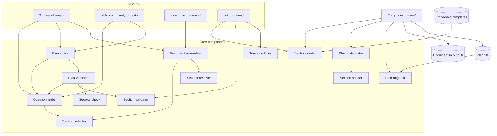

# Components

Status: accepted

The parts of the tool, and which may depend on which. Each component has one responsibility and can be deleted and rebuilt from its contract. The rules and the full responsibilities are in [0020](../decisions/0020-binary-structure-and-regenerative-components.md). Terms are in the [glossary](../glossary.md).

Arrows point from a component to what it depends on. Every component also depends on the domain model, which is left out of the diagram.

## Responsibilities

| Component | Does |
| --- | --- |
| Question finder | Finds a plan's active questions, one per section placeholder plus one `enabled` toggle per optional section, with their values, groups, and suggestions, evaluates question conditions, and the required ones with no value. Reads only |
| Plan validator | Checks whether a plan's values are acceptable: type, options, pattern, and the secrets check. Checks each section's structure by calling the section validator |
| Section validator | Checks one section's own structure, whether it is a template or a section in a plan: placeholders declared and used, defaults that fit their type and pattern, reserved names, and condition references and cycles. Lint rules for conditions, such as a one-entry `isOneOf`, live here |
| Template linter | Checks the hygiene of template text against a rules file: client names, URLs, email addresses, broken links, and voice rules such as em dashes and banned filler words. Takes parsed templates, returns findings |
| Plan editor | Returns a copy of a plan with one answer applied. The copy differs only in `values`. The plan it was given is not altered |
| Document assembler | Turns a plan into a document in an output style, with a gap table and the review marker |
| Plan instantiator | Builds the default plan from the templates and the axis questions, once, when a new plan starts |
| Plan migrator | Returns a copy of an older plan in the current schema version |
| Section loader | Reads template files and decodes them strictly |
| Section selector | Finds the active sections of a plan from its answers, and orders them |
| Section resolver | Fills a section's placeholders from the plan's values |
| Section hasher | Computes the content hash recorded in a section's `source` |
| Secrets check | Decides whether a value looks like a token |

Drivers hold the current plan, read and write plan files, and show results. They contain no rules about questions or content.

## Side effects and plan access

Two declarations for every component, stated in its contract and checked by a property test.

- **Side effects** are what a component does outside the plan. Only drivers and the entry point read or write files. Every other component has no side effects and returns values.
- **Plan access** is what a component does with a plan it was given. Plans are values, so no component alters one. A component **reads** fields, or **returns a changed copy** that differs only in the fields it declares, or **creates** a plan from inputs that are not a plan.

| Component | Side effects |
| --- | --- |
| `section/loader` | Reads template files |
| `plan/migrator`, `plan/instantiator` | None. They return values |
| `question/finder`, `plan/validator`, `plan/editor` | None. The editor returns a changed copy and the driver holds it |
| `section/selector`, `section/resolver`, `section/hasher`, `section/validator`, `template/linter`, `secrets` | None |
| `document/assembler` | None. It returns the document |
| `tui`, `stdio`, `assemble` commands | Read and write plan files, and write the document, only after a confirmed action or an explicit command |
| `lint` command | Reads template files and the lint rules file, prints findings, and exits non-zero on any finding. Writes no files |
| `binary` | Reads embedded templates, wires the components, writes only through the drivers |

R means reads. W means returns the field changed, in a copy. C means creates the field, in a new plan.

| Component | `schemaVersion` | `provenance` | `questions` | `values` | section content | `source` |
| --- | --- | --- | --- | --- | --- | --- |
| `plan/instantiator` | C | C | C | C | C | C |
| `plan/migrator` | W | W | W | W | W | W |
| `plan/editor` | | | | W | | |
| `question/finder` | | | R | R | R | |
| `plan/validator` | | | R | R | R | |
| `section/selector` | | | | R | R | |
| `section/resolver` | | | | R | R | |
| `section/hasher` | | | | | R | |
| `section/validator` | | | | | R | |
| `document/assembler` | R | R | R | R | R | |
| Update action, deferred | | W | | | W | W |

A person editing a plan by hand can change anything, and the plan validator checks the result on load. The template linter takes templates and not plans, so it has no row in the plan access table.

## Dependency rules

Written out in 0020. In short:

- A component may depend only on components earlier in the dependency order. Two components at the same position may not depend on each other.
- The domain model depends on nothing. Core components never depend on the TUI.
- The document assembler never touches templates, so a plan assembles on its own.
- Only the `actions` package may run commands or open URLs, in v2.
- Architecture tests and a dependency check enforce these in `just pre-commit`.

## Commands

| Command | Does |
| --- | --- |
| `onboard-kit` | Starts the TUI walkthrough |
| `onboard-kit assemble --plan <file>` | Assembles a document from a plan. Experimental |
| `onboard-kit stdio` | Exposes the plan components over stdin and stdout, for black-box tests. Experimental |
| `onboard-kit lint` | Checks templates: structure, hygiene, and voice. Reads files, prints findings, and exits non-zero on any finding |

## Open questions

Open questions for components are listed in [0020](../decisions/0020-binary-structure-and-regenerative-components.md) and [0010](../decisions/0010-plan-editor.md).
