# Components

Status: accepted

The parts of the tool, and which may depend on which. Each component has one responsibility and can be deleted and rebuilt from its contract. The rules and the full responsibilities are in [0020](../decisions/0020-binary-structure-and-regenerative-components.md). Terms are in the [glossary](../glossary.md).

Arrows point from a component to what it depends on. Every component also depends on the domain model, which is left out of the diagram.

```mermaid
flowchart TB
    subgraph drivers["Drivers"]
        tui["TUI walkthrough"]
        stdio["stdio command, for tests"]
        assemble_command["assemble command"]
        lint_command["lint command"]
    end

    entry["Entry point, binary/"]

    subgraph core["Core components"]
        finder["Question finder"]
        validator["Plan validator"]
        editor["Plan editor"]
        assembler["Document assembler"]
        instantiator["Plan instantiator"]
        refresher["Plan refresher"]
        migrator["Plan migrator"]
        decoder["Plan decoder"]
        encoder["Plan encoder"]
        recorddecoder["Record decoder"]
        recordencoder["Record encoder"]
        joiner["Record joiner"]
        splitter["Record splitter"]
        reconciler["Record reconciler"]
        loader["Section loader"]
        selector["Section selector"]
        evaluator["Condition evaluator"]
        resolver["Section resolver"]
        hasher["Section hasher"]
        sectionvalidator["Section validator"]
        linter["Template linter"]
        secrets["Secrets check"]
    end

    templates[("Embedded templates")]
    planfile[("Plan file")]
    document[("Document in output/")]

    tui --> finder
    tui --> editor
    tui --> assembler
    stdio --> finder
    stdio --> editor
    assemble_command --> assembler
    lint_command --> loader
    lint_command --> sectionvalidator
    lint_command --> linter

    finder --> selector
    finder --> evaluator
    selector --> evaluator
    validator --> finder
    validator --> sectionvalidator
    validator --> secrets
    editor --> finder
    editor --> validator
    assembler --> selector
    assembler --> resolver
    instantiator --> hasher

    entry --> loader
    entry --> instantiator

    templates --> loader
    planfile --> decoder
    decoder --> migrator
    tui --> decoder
    tui --> encoder
    entry --> document
    entry --> planfile
```

## Responsibilities

| Component | Does |
| -- | -- |
| Question finder | Finds a plan's active questions, one per section variable plus with their answers, groups, and suggestions, evaluates question conditions, and the required ones with no value. Reads only |
| Plan validator | Checks whether a plan's answers are acceptable: type, options, pattern, and the secrets check. Checks directory integrity and duplicate section IDs, variable names within each scope, nonempty step IDs within each section, and plan team declarations. Reads step IDs for that identity check. Checks each section's structure by calling the section validator, and the relations between sections: references to other sections' questions, `after` references, dependency and condition cycles, and timing conflicts |
| Section validator | Checks one section's own structure, whether it is a template or a section in a plan: variables declared and used, defaults that fit their type and pattern, reserved names, references within the section, the `$` rule, check shapes, and `escalation` references, with warnings for thin contacts and single points of failure. Lint rules for conditions, such as a one-entry `isOneOf`, live here |
| Template linter | Checks the hygiene of template text against a rules file: client names, URLs, email addresses, and broken links. Takes parsed templates, returns findings. Voice rules are not here. Vale checks them, see [dev tooling](../stack/dev-tooling.md) |
| Plan editor | Returns a copy of a plan with one answer applied, one section's switch changed, or one directory entry added, changed, or removed. An answer changes only `answers`, a switch only that section's `enabled`, and a directory edit only the directory. Removing an entry also clears the answers and holder entries that named it, and reports them. The plan it was given is not altered |
| Document assembler | Turns a plan into a document in an output style, with a gap table and the review marker |
| Plan instantiator | Builds the default plan from the templates and the axis variables, once, when a new plan starts |
| Plan refresher | Brings a personal plan up to date with a newer org plan, by a three-way comparison of the cached org plan, the new org plan, and the personal plan. Returns the new personal plan and a report of what changed |
| Plan migrator | Deferred until the first breaking schema change. Brings a plan's bytes from one schema version to the next. One step per version, bytes in and bytes out, so it needs no current types. Steps chain |
| Plan decoder | Turns plan file bytes into a Plan and problems. Refuses a version older than supported or newer than known, applies the migrator steps once any exist, decodes leniently so unknown fields survive, and reports format guard violations such as `yes` for a boolean, anchors, and aliases |
| Plan encoder | Turns a Plan into canonical bytes: fixed key order, lowercase booleans, no anchors, so the same plan always gives the same bytes |
| Record decoder | Turns onboarding record file bytes into a Record and problems, with the same format guards as the plan decoder. Refuses a file whose `kind` is not `record` |
| Record encoder | Turns a Record into canonical bytes, so the same record always gives the same bytes |
| Record joiner | Puts a newcomer's onboarding record over the plan, giving the one plan value that every other component takes |
| Record splitter | Takes the onboardee answers back out of the joined plan, giving the record to save. The plan is left alone |
| Record reconciler | Checks a record against a new plan. Removes answers the plan no longer accepts, lists hidden answers, new questions, and new and removed sections, and flags outcomes whose section changed. Replaces the plan refresher |
| Preparation validator | Checks a person's preparation against trusted account, plan, contact, team, and section identities. Reads preparation and context only, returns problems, and performs no writes. It neither joins answers nor records first use |
| Preparation encoder | Turns a preparation value into canonical YAML bytes without changing it. Preserves representable values and unknown top-level data, reports unsupported values, and neither validates references nor writes files |
| Preparation decoder | Turns preparation YAML bytes into a new value, enforcing file-kind and strict format guards. Preserves unknown root data, rejects duplicate raw keys and unknown fixed nested keys, and leaves semantic checks to the preparation validator |
| Preparation editor | Returns preparation with an explicitly replaced recipient, replaced or appended arrangement, or removed arrangement. Validates the requested change after identity and ambiguity guards while preserving unrelated details. Does not certify invitation readiness |
| Preparation locator | Derives a person's relative record path and fixed preparation sibling from explicit account and results-path strings. Rejects ambiguous layouts, unsafe lexical forms, collisions, and oversized expansion. Does not inspect the filesystem or authorize writes |
| Preparation command | Loads an explicit plan and one person's preparation, applies explicit edits through the preparation editor, or shows preparation beside read-only record outcomes. Writes only that preparation under the selected root. See [0220](../decisions/0220-preparation-command.md) |
| Invitation encoder | Planned pure encoder of four opaque payloads into a deterministic bounded ZIP envelope. Does not decode artifacts or create a record seed. See [0240](../decisions/0240-invitation-archive-envelope.md) |
| Invitation decoder | Planned pure decoder of a bounded untrusted ZIP envelope into four owned opaque payloads and their account namespace. Does not extract files or authorize import |
| Section loader | Turns template file bytes into sections, decoding strictly. A driver supplies the bytes |
| Section selector | Finds the active sections of a plan: each section's `includeIf` and `enabled` setting, ordered by `timing`, then `after`, then `id` |
| Condition evaluator | Decides whether a condition holds, given the settled answers of the questions it names. Used for `askIf` and `includeIf`. Takes values and returns true or false |
| Section resolver | Fills a section's variables from the plan's answers, and fills `contact`, `role`, and `team` variables from the directory and the answered team |
| Section hasher | Computes the content hash recorded in a section's `source` |
| Secrets check | Decides whether a value looks like a token |

Drivers hold the current plan, read and write plan files, and show results. They contain no rules about questions or content.

## Side effects and plan access

Two declarations for every component, stated in its contract and checked by a property test.

- **Side effects** are what a component does outside the plan. Only drivers and the entry point read or write files. Every other component has no side effects and returns values.
- **Plan access** is what a component does with a plan it was given. Plans are values, so no component alters one. A component **reads** fields, or **returns a changed copy** that differs only in the fields it declares, or **creates** a plan from inputs that are not a plan.

| Component | Side effects |
| -- | -- |
| `section/loader`, `plan/migrator`, `plan/decoder`, `plan/encoder`, `plan/instantiator`, `record/decoder`, `record/encoder`, `record/joiner`, `record/splitter`, `record/reconciler` | None. They take and return values, and a driver reads and writes the files |
| `question/finder`, `plan/validator`, `plan/editor`, `plan/refresher` | None. The editor and the refresher return a changed copy and the driver holds it |
| `condition/evaluator`, `section/selector`, `section/resolver`, `section/hasher`, `section/validator`, `template/linter`, `secrets` | None |
| `document/assembler` | None. It returns the document |
| `tui`, `stdio`, `assemble` commands | Read and write plan files, and pass the bytes to the decoder and encoder, and write the document, only after a confirmed action or an explicit command |
| `lint` command | Reads template files and the lint rules file, passes template bytes to the section loader, prints findings, and exits non-zero on any finding. Writes no files |
| `binary` | Reads embedded templates, wires the components, writes only through the drivers |
| `preparation/validator` | None. Reads Preparation and the contract's Context projection, including optional record identity. Returns problems only; reads or changes no Plan fields or record answers, outcomes, or notes |
| `preparation/encoder` | None. Reads every Preparation field and returns bytes and problems. Reads or changes no Plan or record fields |
| `preparation/decoder` | None. Reads supplied bytes and creates Preparation and problems. Reads or changes no Plan or record fields |
| `preparation/editor` | None. Reads Preparation and trusted context; returns only Recipient or Arrangements changed. Changes no Plan, record, identity, or unknown-field data |
| `preparation/locator` | None. Reads only supplied resultsPath and account strings, returning relative paths and problems. Reads or changes no Plan, preparation body, record, environment, or filesystem |
| `command/prepare` | Reads an explicit plan, arguments, and preparation; show also reads the selected record. Writes stdout, stderr, and only the selected preparation plus its missing parent directories and temporary publication file. Changes no Plan or record bytes |
| `invitation/encoder` | None. Reads InvitationFiles only and returns archive bytes or problems; reads or changes no Plan, Preparation, or Record fields |
| `invitation/decoder` | None. Reads archive bytes only and returns owned InvitationFiles or problems; reads or changes no Plan, Preparation, or Record fields |

R means reads. W means returns the field changed, in a copy. C means creates the field, in a new plan. The plan migrator works on bytes and not on a plan, so it has no row.

| Component | `schemaVersion` | `id` | `provenance` | `origin` | `directory` | `variables` | `answers` | section content | `source` |
| -- | -- | -- | -- | -- | -- | -- | -- | -- | -- |
| `plan/instantiator` | C |  | C |  |  | C | C | C | C |
| `plan/decoder` | C | C | C | C | C | C | C | C | C |
| `plan/encoder` | R | R | R | R | R | R | R | R | R |
| `plan/editor` |  |  |  |  | W |  | W | W |  |
| `plan/refresher` |  |  |  | W | W | W | W | W | W |
| `question/finder` |  |  |  |  | R | R | R | R |  |
| `plan/validator` |  |  |  |  | R | R | R | R |  |
| `section/selector` |  |  |  |  |  |  | R | R |  |
| `section/resolver` |  |  |  |  | R |  | R | R |  |
| `section/hasher` |  |  |  |  |  |  |  | R |  |
| `section/validator` |  |  |  |  |  |  |  | R |  |
| `document/assembler` | R | R | R | R | R | R | R | R |  |
| Update action, deferred |  |  | W |  |  |  |  | W | W |

A person editing a plan by hand can change anything, and the plan validator checks the result on load. The template linter takes templates and not plans, so it has no row in the plan access table.

## Dependency rules

Written out in 0020. In short:

- A component may depend only on components earlier in the dependency order. Two components at the same position may not depend on each other.
- The domain model depends on nothing. Core components never depend on the TUI.
- The document assembler never touches templates, so a plan assembles on its own.
- Only the `actions` package may run commands or open URLs, in v2.
- Architecture tests and a dependency check enforce these in `just check`.

The preparation decoder, encoder, and validator depend only on the domain model and their
own contract interfaces. They do not depend on each other, plan or record codecs,
or drivers. Drivers perform semantic validation separately from serialization.
The preparation editor may depend on the preparation validator, including its
contract's context projection, and model, plus its own contract interface. It
does not depend on codecs or drivers.
The preparation locator depends only on its own contract interface and the
domain model. It does not depend on other components or drivers.
The preparation command is a driver. It may depend on plan decoding and validation,
the preparation locator, decoder, encoder, validator and editor, record decoding,
the domain model, and its own contract interface. It does not depend on other
command drivers, template loading, record editing, or the plan refresher.
The invitation encoder and decoder depend only on the domain model and their
own contract interfaces. Neither depends on the other, artifact codecs, the
locator, or drivers. Artifact validation and filesystem publication are separate
driver responsibilities.

## Commands

| Command | Does |
| -- | -- |
| `onboard-kit` | Starts the TUI walkthrough |
| `onboard-kit assemble --plan <file>` | Assembles a document from a plan. Experimental |
| `onboard-kit stdio` | Exposes the plan components over stdin and stdout, for black-box tests. Experimental |
| `onboard-kit lint` | Checks templates: structure and hygiene. Builds the default plan from the template set and runs the plan validator, to cover checks across templates. Reads files, prints findings, and exits non-zero on any finding |
| `onboard-kit prepare <operation> --plan <file> --account <id>` | Initializes or edits one person's preparation, or displays preparation and recorded outcomes without changing the record |

## Open questions

Open questions for components are listed in [0020](../decisions/0020-binary-structure-and-regenerative-components.md) and [0010](../decisions/0010-plan-editor.md).
