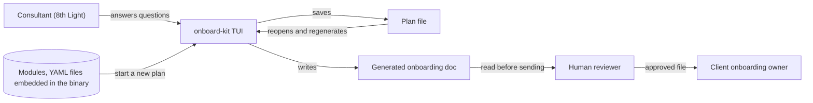

# Context

Status: accepted

Who and what touches onboard-kit. The tool is internal. The client receives only the generated file.

> [!NOTE]
> **What is a module?**
>
> A module is one YAML file holding a single piece of onboarding content, such as the first week plan or the access checklist. It says when to include it, which placeholders it needs, and what steps it contains. Prose fields hold Markdown text. A new plan starts with every standard module as a section, and the walkthrough answers decide which sections are active. Modules are plain data, so people and agents can write and validate them without special tooling. See [module schema](../reference/module-schema.md) and the [ACME example](../reference/examples/acme/README.md).

## Notes

- Modules ship inside the binary, so every consultant on the same version starts from the same content.
- The plan file stands alone. It holds every section, the questions, and the answers, so it reopens without the modules. See [0030](../decisions/0030-self-contained-plan-file.md).
- The plan file and the generated doc contain client specifics. Both are written under `output/`, which git ignores.
- A human reviews every document before it leaves 8th Light. The tool reminds the consultant but cannot enforce it.
- The client never runs the tool. They get a file in the format the consultant chose. The plan file may travel with the document, and the client can keep it.

## Open questions

- Who reviews, and what do they check? See [#12](https://github.com/8thlight-daveloper/onboard-kit/issues/12).
- If we host a web version, this picture changes. See [#4](https://github.com/8thlight-daveloper/onboard-kit/issues/4).
