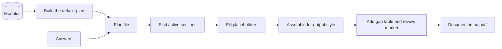

# Data flow

Status: accepted

How modules and answers become a document. Every step is deterministic.

The first two steps run once, when a new plan starts. After that the plan is the only input. Applying an answer produces a new plan, and assembling always starts from the plan.

## Properties

- **Repeatable.** The same plan gives byte-identical output. Tests can assert this.
- **Regenerable.** Edit the plan, run again, and get a new document. No re-asking.
- **Standalone.** The plan holds every section, so it reopens and assembles without the modules.
- **Several styles from one plan.** The output style is an option when assembling. The MVP has one style, Markdown.
- **Visible gaps.** A value marked `unknown-yet` renders as a to-do the reviewer cannot miss, and the gap table lists it with an owner and timing.
- **Review marker.** Output carries a marker until a person removes it.

## What the plan holds

| Field | Purpose |
| --- | --- |
| `schemaVersion` | The version of the plan format |
| `provenance` | The module set version and the generated date |
| `questions` | Plan-level questions, such as team state, discipline, and the document details |
| `values` | The answer to every question |
| `sections` | Every module as a section, with placeholders unresolved, and a record of its source |

See [0030](../decisions/0030-self-contained-plan-file.md) for the format, versioning, and how updates will work.

## File format and name

Plans are YAML, named `<name>.obk.yaml`, for example `acme.obk.yaml`. The double extension lets the tool find its own files while editors still highlight the YAML. Consultants can edit the file by hand, and the TUI loads it for further editing. Loading brings an older plan up to the current version, and validates it, including the secrets check on its values.

## Open questions

Open questions for the plan format are in [0030](../decisions/0030-self-contained-plan-file.md).
