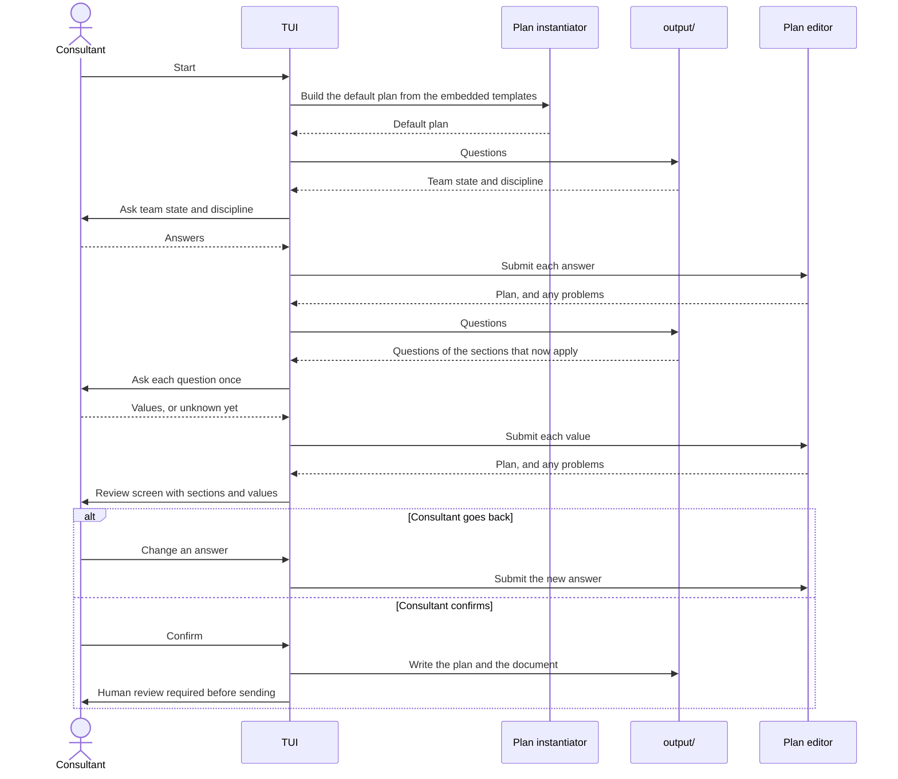
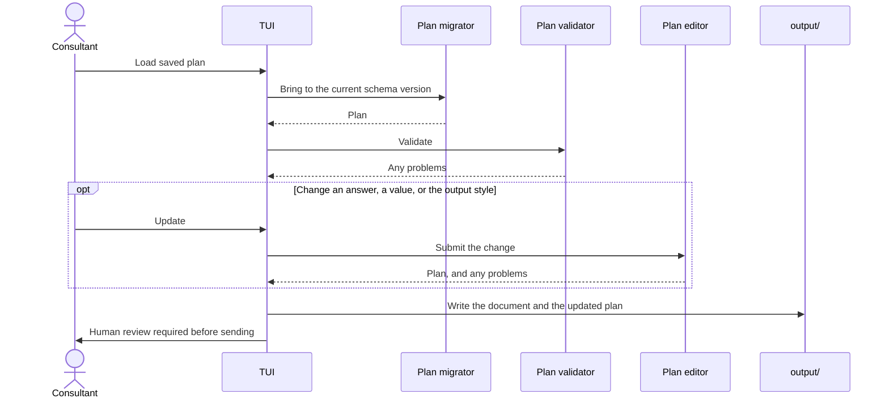

# Walkthrough sequence

Status: accepted

One run of the TUI, first for a new plan and then reopening a saved one. The calls are defined in [0010](../decisions/0010-plan-editor.md), which has the same flows with the detail of problems and held plan values. The question finder reads, the plan validator checks, and the plan editor changes.

## New plan

## Reopen

## Entry and navigation

The TUI has no separate edit mode. A new plan and an opened plan go through the same questions. The only difference is where the plan comes from, the default plan or a file. The review screen is the home screen.

| Situation | Where the consultant lands |
| -- | -- |
| New plan | The first question. They walk the questions, then reach the review screen |
| Opened plan with problems, or required questions with no value | The first problem or blocker, since the plan is not ready |
| Opened plan, ready | The review screen |

The review screen offers three things: change an answer, by walking from the first question or jumping to one; assemble the document; quit without writing.

`onboard-kit` shows a start screen with "New plan" and "Open plan". `onboard-kit <file>` opens that plan directly.

Nothing is written until the consultant confirms. The review screen does not write silently.

The v2 onboarding helper is a separate activity for the person being onboarded. It will be offered from the review screen when a plan is ready. It is not a mode of the walkthrough, and it needs per-person progress, which does not live in the plan.

## Notes

- The template set is needed only to start a new plan. Reopening, editing, changing team state or discipline, and assembling all work from the plan alone.
- The consultant can back out at the review screen without writing anything.
- A consultant can walk the questions from the first, with existing values as defaults, or jump to one question from the review screen.
- Assembling a document without the TUI is `onboard-kit assemble`. See [0010](../decisions/0010-plan-editor.md).
- The reminder about human review appears on every run that writes a document.

## Open questions

Which questions are optional is decided by each template with `required` and `default`, see [0010](../decisions/0010-plan-editor.md). An optional section declares an `enabled` placeholder, which is asked like any other question.
