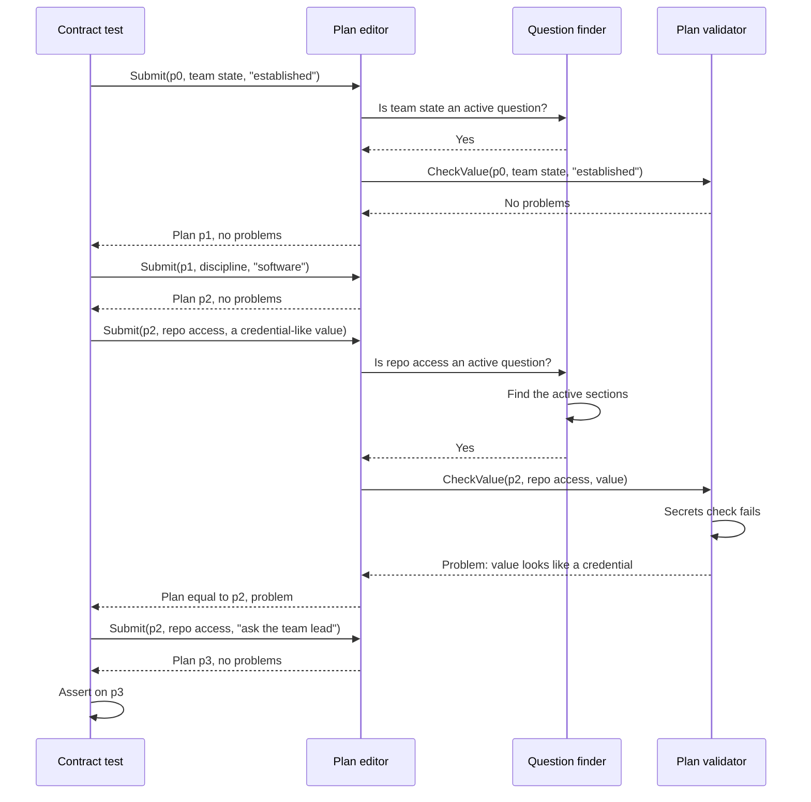
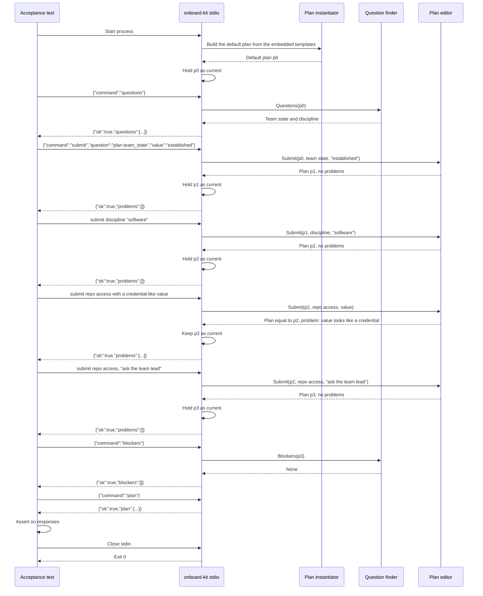
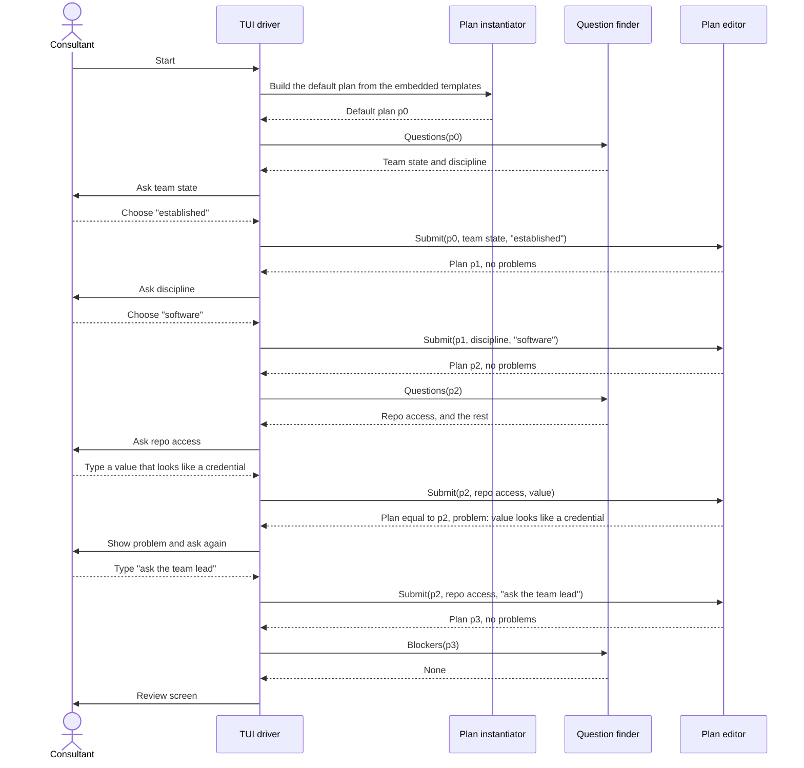
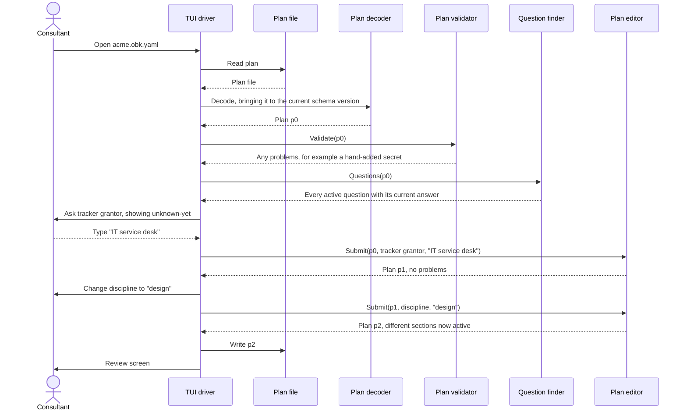

# 0010. Plan editor

Status: accepted

Relates to [#24](https://github.com/8thlight-daveloper/onboard-kit/issues/24), [#6](https://github.com/8thlight-daveloper/onboard-kit/issues/6), [#23](https://github.com/8thlight-daveloper/onboard-kit/issues/23). The plan file it works on is defined in [0030](0030-self-contained-plan-file.md).

## Context

The walkthrough decides which questions to ask, validates answers, and builds the plan. If that logic lives in the user interface layer, only that interface can exercise it. A headless `assemble` command tests only the last step, from a finished plan to a document. Nothing tests how the plan came to be: optional and required questions, validation, the secrets check, or editing an existing plan.

We also want components that can be deleted and rebuilt, judged by independent tests. A component that cannot be driven without a terminal cannot be judged that way.

## Decision

Split reading a plan, checking a plan, and changing a plan into three components. Each is a set of functions over a plan and holds no state of its own.

- All state lives in the plan. Each function takes a plan and returns a plan, or a report about one.
- Calls take and return plain serializable types. No terminal concerns such as prompts, defaults display, or styling.
- These components never read or write files. Drivers do.

Surface, as a sketch:

```go
// question/finder, reads only
Questions(plan) []Question                 // active questions in order, each with its current answer, groups, and suggestions
Blockers(plan) []Blocker                   // required questions with no answer, which stop assembly

// plan/validator, checks only
Validate(plan) []Problem                   // checks a loaded plan, for example after a hand edit
CheckValue(plan, id, value) []Problem      // checks one value: type, options, pattern, the secrets check

// plan/editor, the only one of the three that returns a changed copy of a plan
Submit(plan, id, value) (Plan, []Problem)  // id is <scope>.<name>. Returns a new plan and any problems
```

Why three. What a plan asks, whether its answers are acceptable, and how an answer is applied to it are separate jobs with separate reasons to change. Others need the first two without the third. The TUI reads questions, the document assembler and a later onboarding helper read the plan, and a helper that only runs steps never changes it. A plan type carrying these rules would put fast-changing logic in the domain model, which sits at the slowest rate of change and needs an ADR to change.

### Starting and opening

- **A new plan** is the default plan: the axis variables and every standard template as a section, with no answers. The plan instantiator builds it from the embedded templates. See [0030](0030-self-contained-plan-file.md).
- **An opened plan** is read from a file by a driver, decoded by the plan decoder, which brings it to the current schema version, and checked with `Validate`.

Either way the components get a plan, and need no templates. Answering the axis variables changes which sections are active, and the finder works that out from the plan with the section selector. Changing team state or discipline works on any plan.

### Plans are values

This is the functional style set out in [0015](0015-functional-core-and-imperative-shell.md).

No function alters the plan it is given. Each returns a new one. If an answer has an error, it is not applied, and the returned plan equals the original. A warning is returned with the new plan and never stops an answer or assembly.

- **Undo is free.** The review screen's "go back" keeps earlier plan values and returns to one.
- **Tests can fork.** One test builds a plan up to a shared point and tries many next answers from it, independently and in parallel.
- **No shared mutation.** A plan can be read from several goroutines without locks.
- **Plain fixtures.** A contract fixture is three plan files: the plan before, the answer given, and the plan after.
- **Drivers hold the current plan.** The stdio process and the TUI each keep a reference and replace it with the plan `Submit` returns.

The cost is one small copy per answer. Questions number in the tens, so this does not matter.

### Walking the questions

`Questions(plan)`, from the question finder, returns every active question, each with its current answer or default.

- **One question per variable.** The active questions are the plan variables plus every variable of every active section. Each keeps its own description, type, `required`, and default, and its id is `<scope>.<name>`, such as `access.repo_url`.

- **Groups.** Questions with the same name, type, options, and `multiple` form a group. A user interface can ask a group once and apply the answer to every member, with one `Submit` each, and a person can split it. Grouping is data the finder returns. It is not a rule that merges anything.

- **Suggestions.** A question's suggestions are the distinct declared defaults in its group, plus the answers already given for that name in any scope, the plan's and every section's, inactive ones included. For a `boolean` or `choice` only valid values are offered. For a `string` with a `pattern`, a candidate that does not match is dropped.

- **Entry rules.** Free entry is allowed for `string` and `command`. A `boolean` or `choice` accepts only its options. `unknown-yet` is always offered, as its own entry.

- **Optional sections.** A section that can be switched off declares an `enabled` variable. It is a boolean question with id `<section>.enabled`, asked before that section's other questions. When the answer is false, the section's other questions are inactive. See [section template schema](../reference/section-template-schema/optional-sections.md).

- **Phase.** Questions with `phase: onboarding` are not returned for planning. They are not asked and do not block.

- **Order.** Plan variables come first, then each active section's questions in document order, which [ordering](../reference/section-template-schema/ordering.md) defines. A question is never asked before the questions its condition names.

- **Walking.** A user interface can walk the questions from the first, with existing answers as defaults, or jump to one from a review screen. Both are interface choices, and the finder supports either. It stores no resume position, because the plan is the only state.

- **Conditions.** A variable can carry an `askIf` question condition on other answers. A question whose condition is false is not active. It keeps its stored answer, is not asked, and does not block. A condition is true only when every question it tests has a real answer, which is a stored answer that is not `unknown-yet` and not a default nobody selected. The exception is `isAnswered`. The finder evaluates conditions. The plan validator reports unknown references, condition cycles, and the dependency and timing problems between sections. It calls the section validator for each section's own structure. The syntax is in [section template schema](../reference/section-template-schema/conditions.md).

Four drivers share these functions:

| Driver | Input | Does |
| -- | -- | -- |
| TUI | Keystrokes | Shows `Questions()`, forwards input to `Submit`, shows problems |
| Headless assemble | A plan file | Runs `Validate()` and `Blockers()`, then assembles the document |
| Stdio | JSON commands on stdin | Exposes the functions over stdio for black-box tests |
| Contract test | Go calls | Calls the functions directly and asserts on the plan |

Headless assemble is not a separate pipeline. It is the same components with no human.

### Commands

Both are experimental until after the MVP, so scripts that depend on them carry no stability promise.

`assemble` is the deterministic step from a plan to a document. It matches the architecture principle "Deterministic assembly" and avoids confusion with drawing a terminal screen.

- `onboard-kit assemble --plan <file>` assembles a document from a plan, with an optional `--style`. It replaces the earlier deferral of non-interactive document assembly. Acceptance tests use it to judge plan in, document out.
- `onboard-kit stdio` exposes the plan components over stdin and stdout, as a transport for tests. It is not an edit mode of the TUI. The process starts from the default plan, or opens one given `--plan <file>`. The process holds the current plan, so there is no ID of any kind. Acceptance tests use it to judge the whole app, including the question flow.

The stdio protocol is line-delimited JSON, one request per line and one response per line, in order. Sketch:

```text
-> {"command":"questions"}
<- {"ok":true,"questions":[{"question":"plan.team_state","type":"choice","options":["established","first-consultants"],"answer":null}]}
-> {"command":"submit","question":"plan.team_state","value":"established"}
<- {"ok":true,"problems":[]}
-> {"command":"blockers"}
<- {"ok":true,"blockers":[]}
-> {"command":"plan"}
<- {"ok":true,"plan":{}}
-> {"command":"nonsense"}
<- {"ok":false,"error":{"code":"unknown_command","message":"unknown command: nonsense"}}
```

The adapter holds no logic of its own. Each command maps to one editor function, and each response is that function's serializable result. Each test starts its own process, so tests stay independent. No ports, sockets, or auth are involved.

### State

- **Call and response.** Every call is synchronous and returns a result, like a request to an HTTP API. The editor never waits for a human and never calls back into a driver. A driver that wants an answer asks the human, then calls `Submit`.
- **Where state lives.** In the plan, held by the driver. Nothing is stored between runs.
- **What persists.** The plan file, which holds everything needed to reopen it. See [0030](0030-self-contained-plan-file.md).

### Where the behavior lives

The finder owns what is asked, the validator owns what is acceptable, and the editor owns applying an answer.

- **Optional, required, and default.** A variable carries `required` and `default`. `Blockers()` lists active required planning questions with no answer, each judged by its own definition. Which questions are required is content, set by each template, including engagement-specific templates. This settles the architecture side of [#6](https://github.com/8thlight-daveloper/onboard-kit/issues/6).
- **Conditions.** The finder evaluates them, and the validators check them. See above.
- **Secrets.** The check runs in `Submit` and in `Validate`, so a secret added to a plan by hand is reported as a problem.
- **Unknown answers.** The value `unknown-yet` lets a person move past a question they cannot answer yet and return to it later. It is an accepted answer. It satisfies a required question, becomes a gap when assembling, and a user interface can list these questions on the review screen.

### Errors and shutdown

Errors fall into four classes.

| Class | Example | Handling |
| -- | -- | -- |
| Problem | Secret-like value, unknown question id, a value of the wrong type. Severity `error` or `warning` | Normal result, not a tool failure. A warning never blocks |
| Blocker | Required question has no answer | Normal result, stops assembly |
| Protocol or usage error | Bad JSON, unknown command, unreadable file | Tool error |
| Internal failure | Panic, bug | Tool error, non-zero exit |

`onboard-kit assemble` exit codes:

| Code | Meaning |
| -- | -- |
| 0 | Document assembled |
| 1 | Problems or blockers. JSON report on stdout, short summary on stderr |
| 2 | Usage error, or plan unreadable or invalid |
| 70 | Internal failure |

Assemble writes nothing on a non-zero exit. The entry point writes the document only after every check passes, to a temporary file that it then renames, so a crash cannot leave a half-written document. The document assembler itself writes nothing.

`onboard-kit stdio`:

- Problems and blockers are `"ok":true` results with the lists filled in.
- A protocol error returns `"ok":false` with an error code, and the process stays alive so a script can recover.
- A panic is caught, written to stderr, and ends the process with exit 70.
- Stdout carries only protocol lines. Logs go to stderr.
- Closing stdin is the normal end signal. The process discards its plan and exits 0. It writes no files, so nothing is left behind.

### Acceptance runner

The acceptance runner reads scenarios, which are data and not code, and drives the built binary. See [0025](0025-contracts-and-tests.md). It handles processes so no scenario does.

- **Assemble runs.** The runner starts the process and captures standard output, standard error, and the exit code. A scenario can expect a failure, such as exit 1 with a report listing a blocker. An unexpected non-zero exit fails the scenario, with standard error and the report in the message.
- **Stdio runs.** The runner sends each request line and reads each response. A response with `"ok":false` fails the scenario unless the scenario expects it. If the process dies mid-scenario, the scenario fails with the exit code and captured standard error. Each read has a deadline, so a hung binary fails the scenario and stalls nothing.
- **Shutdown.** The runner closes standard input, waits briefly for exit, and kills the process if it does not exit. This always runs, after a failed expectation as after a passing one.
- **Runner crashes.** If the runner itself is killed, the child sees standard input close, which is the normal end signal, and exits on its own.
- **Language specifics.** How the current runner does this, for example its cleanup hooks and deadlines, belongs to its code and to [testing](../stack/testing.md), not to this ADR.

### Boundaries

- `question/finder` imports the section selector, the condition evaluator, and the domain model. `plan/validator` imports the finder, the section validator, the secrets check, and the domain model. `plan/editor` imports the finder, the validator, and the domain model. None imports templates or the plan instantiator. See [0020](0020-binary-structure-and-regenerative-components.md) for the dependency rules.
- Drivers import these components. The TUI imports nothing else from core except the document assembler. Drivers call the document assembler with the plan the editor produced.
- All three are regenerable components. The editor's contract fixtures are plan before, answer, and plan after. The finder's are a plan and its expected questions. The validator's are a plan and its expected problems.

## Sequence

### Contract test as the driver

The test calls the editor, which uses the finder and the validator. It judges one component and lives under `contracts/plan/editor/`, starting from a default plan in a fixture. The finder and the validator have their own contract tests.



### Acceptance test as the driver

The test starts the built binary and talks to it over stdio. It judges the whole app and lives under `acceptance/`. It sees only commands and responses, never the components.



### New plan with a consultant



Assembling and writing happen after the review screen, outside these components. The TUI hands the plan to the document assembler and writes the plan file.

### Reopening a plan with a consultant

No templates take part. Everything comes from the plan.



## Consequences

- The walkthrough logic is testable without a terminal.
- The TUI becomes a thin, replaceable driver. A second client, such as a web UI, adds a driver. The stdio adapter already proves the types serialize. A network server would be another thin wrapper over the same functions.
- Acceptance tests can exercise the question flow without a terminal, through the same binary consultants run.
- The stdio protocol is a second public surface beside `assemble`. It is experimental, but breaking it breaks acceptance tests, so changes to it need human approval like any other test change.
- Every question and rule lives in the plan or the editor. A UI that adds its own rules breaks the headless path, so reviews must reject UI-side logic.
- `Submit` must stay free of terminal concerns. This is the main way the design can erode.
- Opening a plan cannot fail because templates changed. The template set matters only when starting a plan or running a later update.
- Any axis change works on any plan, because the plan holds every section.
- Reading, checking, and changing a plan are separate components. A later onboarding helper reads a plan with the finder and the selector, and never needs the editor.
- No state lives outside the plan, so there is nothing to resume, lose, or leak.

## Alternatives considered

- **Logic inside the TUI, headless assemble only.** Cheapest now. Leaves the walkthrough logic untestable without a terminal.
- **A stateful session object.** The earlier design. A session held the plan plus methods, and `Open` and `New` created it. Once the plan carried all the state, the object added a name and an identity and no behavior. Replaced by functions over a plan.
- **Plans that hold only the selected sections.** An earlier design. Changing team state or discipline then needed the template set, which meant an injected `expand` function and refusing the change on an opened plan. Replaced by plans that hold every section, see [0030](0030-self-contained-plan-file.md).
- **Question logic inside the editor.** Fewest components. The TUI, a later onboarding helper, and the assembler would each need to reach into the editor to read a plan. Rejected.
- **Question logic as methods on the plan type.** One object to ask. The domain model is protected and changes only by ADR, and these rules are still moving, see the open questions. The model also sits at dependency order 0 and cannot use the section selector. Rejected.
- **A mutating editor.** `Submit` changes the plan in place. Simpler to write, but "go back" needs undo logic, tests cannot fork from a shared point, and concurrent reads need locks. Rejected.
- **Opening a plan against the template set and reporting drift.** An earlier design. It tied every saved plan to templates that may be missing or changed at the organization that holds it. Replaced by the self-contained plan in [0030](0030-self-contained-plan-file.md).
- **Scanning for orphaned stdio processes at startup.** Rejected. The process holds no ports, locks, or files, and exits on stdin EOF, so orphans need a hung child, which is a bug. A scan cannot tell a stray from a parallel test run or a consultant's live run, so it risks killing the wrong process, and PID files add state to a stateless tool. If a stuck process is ever observed, add an opt-in `--max-lifetime` flag that the test helper sets just above the test timeout, or kill the process group from the helper.
- **A local server with the TUI as a client.** Gives independent clients and a permanent API contract. Costs process lifecycle, socket auth, and wire versioning for a single short-lived client. The stdio adapter above takes the useful part, a black-box protocol, without the network. Revisit a network server if a second concurrent client appears or hosting ([#4](https://github.com/8thlight-daveloper/onboard-kit/issues/4)) becomes real.
