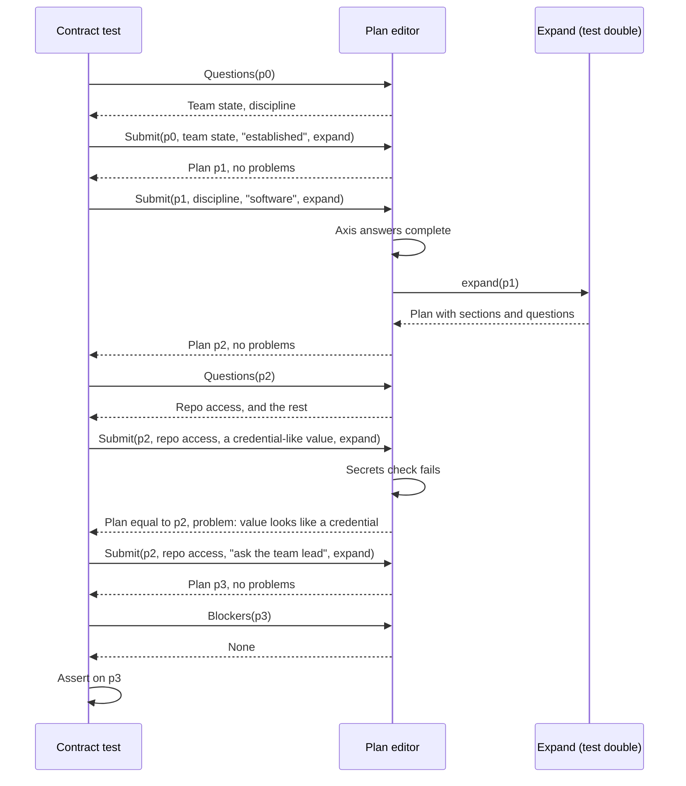
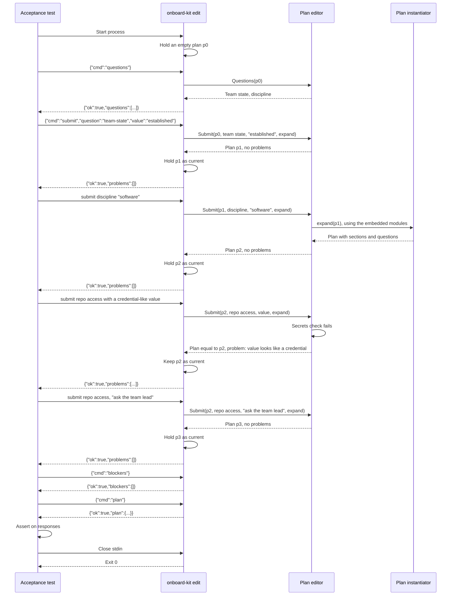
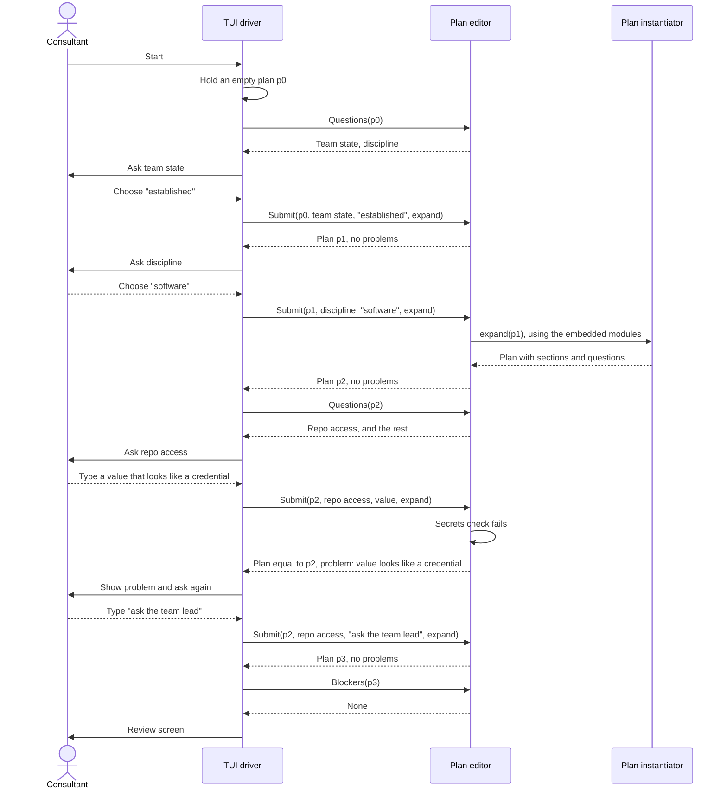
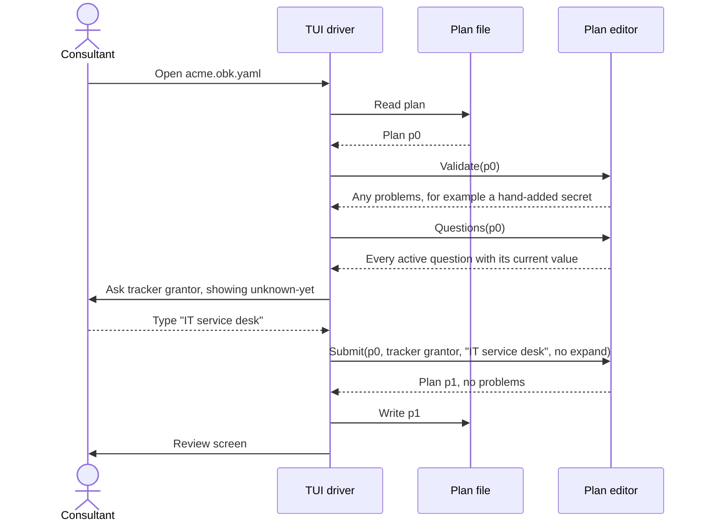

# 0010. Plan editor

Status: proposed

Relates to [#24](https://github.com/8thlight-daveloper/onboard-kit/issues/24), [#6](https://github.com/8thlight-daveloper/onboard-kit/issues/6), [#23](https://github.com/8thlight-daveloper/onboard-kit/issues/23). The plan file it works on is defined in [0030](0030-self-contained-plan-file.md).

## Context

The walkthrough decides which questions to ask, validates answers, and builds the plan. If that logic lives in the user interface layer, only that interface can exercise it. A headless `assemble` command tests only the last step, from a finished plan to a document. Nothing tests how the plan came to be: optional and required questions, validation, the secrets check, or editing an existing plan.

We also want components that can be deleted and rebuilt, judged by independent tests. A component that cannot be driven without a terminal cannot be judged that way.

## Decision

Add a `plan/editor` component. It edits a plan by asking questions and applying answers. It is a set of functions over a plan and holds no state of its own.

- All state lives in the plan. Each function takes a plan and returns a plan, or a report about one.
- Calls take and return plain serializable types. No terminal concerns such as prompts, defaults display, or styling.
- The editor never reads or writes files. Drivers do.

Surface, as a sketch:

```go
Questions(plan) []Question                       // active questions in order, each with its current value or default
Submit(plan, id, value, expand) (Plan, []Problem) // returns a new plan and any problems
Blockers(plan) []Blocker                         // what still stops assembly
Validate(plan) []Problem                         // checks a loaded plan, for example after a hand edit
```

A new plan is the empty plan: the built-in axis questions, team state and discipline, and no sections.

### Expanding a plan

Answering the axis questions decides which modules apply. The editor does not know about modules. The driver passes `expand`, a function from plan to plan, defined in the editor's contract. When the axis answers are complete, `Submit` calls `expand`, and the result has sections and their placeholder questions. Values already given are kept by name when the question still exists.

- For a new plan, the driver binds `expand` to the plan instantiator and the module set embedded in the tool.
- For an opened plan, the driver passes no `expand`. Changing team state or discipline is then refused with a problem, because it changes which sections apply, and the embedded modules may differ from the ones the plan was made from. Updating a plan from a newer module set is a separate action, deferred beyond the MVP. See [0030](0030-self-contained-plan-file.md).

### Plans are values

No function changes the plan it is given. Each returns a new one. If an answer has problems, it is not applied, and the returned plan equals the original.

- **Undo is free.** The review screen's "go back" keeps earlier plan values and returns to one.
- **Tests can fork.** One test builds a plan up to a shared point and tries many next answers from it, independently and in parallel.
- **No shared mutation.** A plan can be read from several goroutines without locks.
- **Plain fixtures.** A contract fixture is three plan files: the plan before, the answer given, and the plan after.
- **Drivers hold the current plan.** The stdio process and the TUI each keep a reference and replace it with the plan `Submit` returns.

The cost is one small copy per answer. Questions number in the tens, so this does not matter.

### Walking the questions

`Questions(plan)` returns every active question, each with its current value or default. A user interface can walk them from the first, with existing values as defaults, or jump to one from a review screen. Both are interface choices, and the editor supports either. It stores no resume position, because the plan is the only state.

A question can carry a condition on other answers. A question whose condition is false is not active. It keeps its stored value, is not asked, and does not block.

Four drivers share these functions:

| Driver | Input | Does |
| --- | --- | --- |
| TUI | Keystrokes | Shows `Questions()`, forwards input to `Submit`, shows problems |
| Headless assemble | A plan file | Runs `Validate()` and `Blockers()`, then assembles the document |
| Stdio edit | JSON commands on stdin | Exposes the functions over stdio for black-box tests |
| Contract test | Go calls | Calls the functions directly and asserts on the plan |

Headless assemble is not a separate pipeline. It is the editor with no human.

### Commands

Both are experimental until after the MVP, so scripts that depend on them carry no stability promise.

`assemble` is the deterministic step from a plan to a document. It matches the architecture principle "Deterministic assembly" and avoids confusion with drawing a terminal screen.

- `onboard-kit assemble --plan <file>` assembles a document from a plan, with an optional `--style`. It replaces the earlier deferral of non-interactive document assembly. Acceptance tests use it to judge plan in, document out.
- `onboard-kit edit` runs the editor over stdio. It starts a new plan, or opens one given `--plan <file>`. The process holds the current plan, so there is no ID of any kind. Acceptance tests use it to judge the whole app, including the question flow.

The stdio protocol is line-delimited JSON, one request per line and one response per line, in order. Sketch:

```
-> {"cmd":"questions"}
<- {"ok":true,"questions":[{"question":"team-state","kind":"choice","options":["established","first-consultants"],"value":null}]}
-> {"cmd":"submit","question":"team-state","value":"established"}
<- {"ok":true,"problems":[]}
-> {"cmd":"blockers"}
<- {"ok":true,"blockers":[]}
-> {"cmd":"plan"}
<- {"ok":true,"plan":{}}
-> {"cmd":"nonsense"}
<- {"ok":false,"error":{"code":"unknown_command","message":"unknown command: nonsense"}}
```

The adapter holds no logic of its own. Each command maps to one editor function, and each response is that function's serializable result. Each test starts its own process, so tests stay independent. No ports, sockets, or auth are involved.

### State

- **Call and response.** Every call is synchronous and returns a result, like a request to an HTTP API. The editor never waits for a human and never calls back into a driver, except through `expand`. A driver that wants an answer asks the human, then calls `Submit`.
- **Where state lives.** In the plan, held by the driver. Nothing is stored between runs.
- **What persists.** The plan file, which holds everything needed to reopen it. See [0030](0030-self-contained-plan-file.md).

### Behavior the editor owns

- **Optional, required, and default.** A question carries `required` and `default` in the plan. `Blockers()` lists required questions with no value. Which questions are required is content, set by each module, including engagement-specific modules. This settles the architecture side of [#6](https://github.com/8thlight-daveloper/onboard-kit/issues/6).
- **Conditions.** How a condition is written belongs to the module schema ([#3](https://github.com/8thlight-daveloper/onboard-kit/issues/3)).
- **Secrets.** The check runs in `Submit` and in `Validate`, so a secret added to a plan by hand is reported as a problem.
- **Unknown values.** The value `unknown-yet` is an accepted answer. It satisfies a required question and becomes a gap when assembling.

### Errors and shutdown

Errors fall into four classes.

| Class | Example | Handling |
| --- | --- | --- |
| Problem | Secret-like value, unknown question id, an axis change on an opened plan | Normal result, not a tool failure |
| Blocker | Required question has no value | Normal result, stops assembly |
| Protocol or usage error | Bad JSON, unknown command, unreadable file | Tool error |
| Internal failure | Panic, bug | Tool error, non-zero exit |

`onboard-kit assemble` exit codes:

| Code | Meaning |
| --- | --- |
| 0 | Document assembled |
| 1 | Problems or blockers. JSON report on stdout, short summary on stderr |
| 2 | Usage error, or plan unreadable or invalid |
| 70 | Internal failure |

Assemble writes nothing on a non-zero exit. The writer runs only after every check passes, and writes to a temporary file then renames, so a crash cannot leave a half-written document.

`onboard-kit edit`:

- Problems and blockers are `"ok":true` results with the lists filled in.
- A protocol error returns `"ok":false` with an error code, and the process stays alive so a script can recover.
- A panic is caught, written to stderr, and ends the process with exit 70.
- Stdout carries only protocol lines. Logs go to stderr.
- Closing stdin is the normal end signal. The process discards its plan and exits 0. It writes no files, so nothing is left behind.

### Acceptance test helper

Acceptance tests share one helper under `acceptance/`, so no test handles processes itself.

- **Assemble runs.** The helper runs the process and captures stdout, stderr, and the exit code. An expected failure is an assertion, for example exit 1 with a report listing a blocker. An unexpected non-zero exit fails the test, with stderr and the report in the message.
- **Edit runs.** The helper wraps the process as a client with `Send(cmd)` returning the parsed response. An `"ok":false` response fails the test unless the test opts in to expect it. If the process dies mid-test, `Send` fails with the exit code and captured stderr. Each `Send` has a read deadline, so a hung binary fails the test instead of stalling the run.
- **Shutdown.** The client registers `t.Cleanup` when it starts. Cleanup closes stdin, waits briefly for exit, and kills the process if it does not exit. `t.Fatal`, `t.FailNow`, and a panic in the test goroutine all run cleanup, so a failed assertion and a passing test shut down the same way.
- **Test crashes.** Cleanup does not run if the test binary is killed, for example by a `go test -timeout` expiry or `os.Exit`. The child then sees stdin close, which is the normal end signal, and exits on its own.
- **Goroutines.** Helpers that run in other goroutines report with `t.Error`, never `t.Fatal`, because `FailNow` is only valid on the test goroutine.

### Boundaries

- `plan/editor` imports the secrets check and the domain model. It never imports modules or the plan instantiator. `expand` is an interface in its contract, and the entry point binds it. See [0020](0020-binary-structure-and-regenerative-components.md) for the dependency rules.
- Drivers import the editor. The TUI imports nothing else from core except the document assembler. Drivers call the document assembler with the plan the editor produced.
- `plan/editor` is a regenerable component. Its contract fixtures are plan before, answer, and plan after.

## Sequence

### Contract test as the driver

The test calls the editor directly. It judges one component and lives under `contracts/plan/editor/`. `expand` is a test double.



### Acceptance test as the driver

The test starts the built binary and talks to it over stdio. It judges the whole app and lives under `acceptance/`. It sees only commands and responses, never the editor package.



### New plan with a consultant



Assembling and writing happen after the review screen, outside the editor. The TUI hands the plan to the document assembler and writes the plan file.

### Reopening a plan with a consultant

No modules take part, and the driver passes no `expand`. Everything comes from the plan.



## Consequences

- The walkthrough logic is testable without a terminal.
- The TUI becomes a thin, replaceable driver. A second client, such as a web UI, adds a driver. The stdio adapter already proves the types serialize. A network server would be another thin wrapper over the same functions.
- Acceptance tests can exercise the question flow without a terminal, through the same binary consultants run.
- The stdio protocol is a second public surface beside `assemble`. It is experimental, but breaking it breaks acceptance tests, so changes to it need human approval like any other test change.
- Every question and rule lives in the plan or the editor. A UI that adds its own rules breaks the headless path, so reviews must reject UI-side logic.
- `Submit` must stay free of terminal concerns. This is the main way the design can erode.
- Opening a plan cannot fail because modules changed. The module set matters only when starting a plan or running a later update.
- No state lives outside the plan, so there is nothing to resume, lose, or leak.

## Alternatives considered

- **Logic inside the TUI, headless assemble only.** Cheapest now. Leaves the walkthrough logic untestable without a terminal.
- **A stateful session object.** The earlier design. A session held the plan plus methods, and `Open` and `New` created it. Once the plan carried all the state, the object added a name and an identity and no behavior. Replaced by functions over a plan.
- **A mutating editor.** `Submit` changes the plan in place. Simpler to write, but "go back" needs undo logic, tests cannot fork from a shared point, and concurrent reads need locks. Rejected.
- **Opening a plan against the module set and reporting drift.** An earlier design. It tied every saved plan to modules that may be missing or changed at the organization that holds it. Replaced by the self-contained plan in [0030](0030-self-contained-plan-file.md).
- **Scanning for orphaned stdio processes at startup.** Rejected. The process holds no ports, locks, or files, and exits on stdin EOF, so orphans need a hung child, which is a bug. A scan cannot tell a stray from a parallel test run or a consultant's live run, so it risks killing the wrong process, and PID files add state to a stateless tool. If a stuck process is ever observed, add an opt-in `--max-lifetime` flag that the test helper sets just above the test timeout, or kill the process group from the helper.
- **A local server with the TUI as a client.** Gives independent clients and a permanent API contract. Costs process lifecycle, socket auth, and wire versioning for a single short-lived client. The stdio adapter above takes the useful part, a black-box protocol, without the network. Revisit a network server if a second concurrent client appears or hosting ([#4](https://github.com/8thlight-daveloper/onboard-kit/issues/4)) becomes real.

## Open questions

- Which axis changes could an opened plan accept without the module set? Today none, and a person starts a new plan or runs the deferred update.
- Are the axis questions fixed in the model, or shipped as a built-in minimal plan so they are data like every other question?
