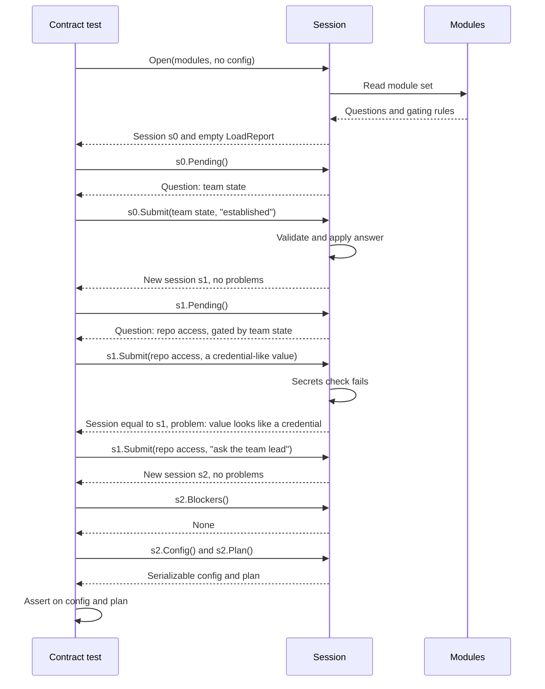
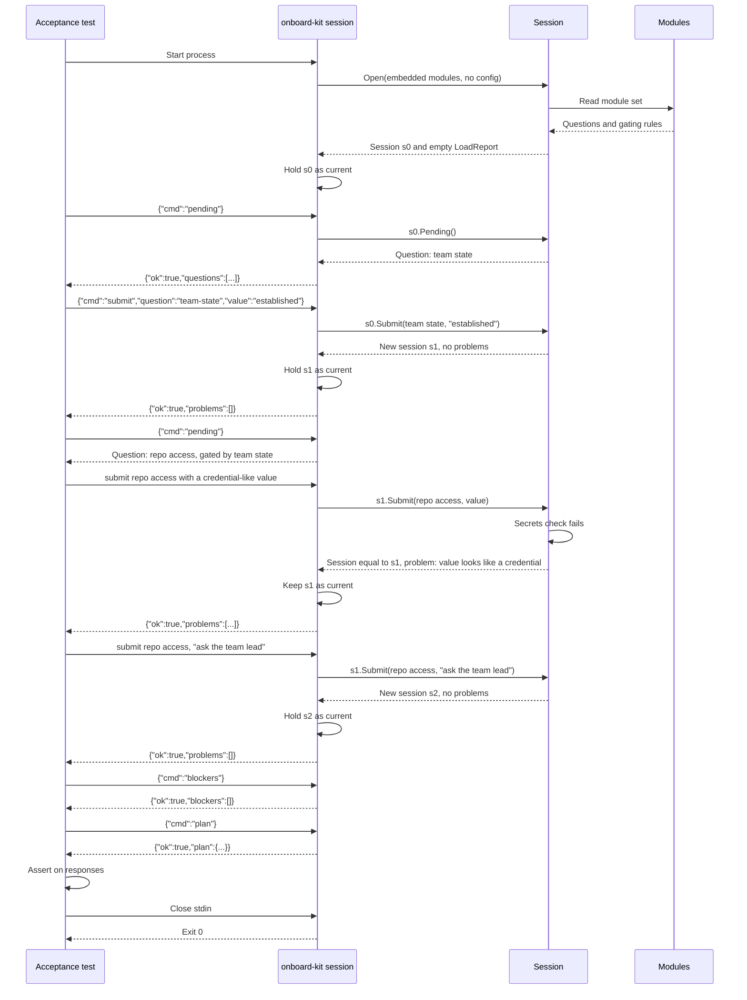
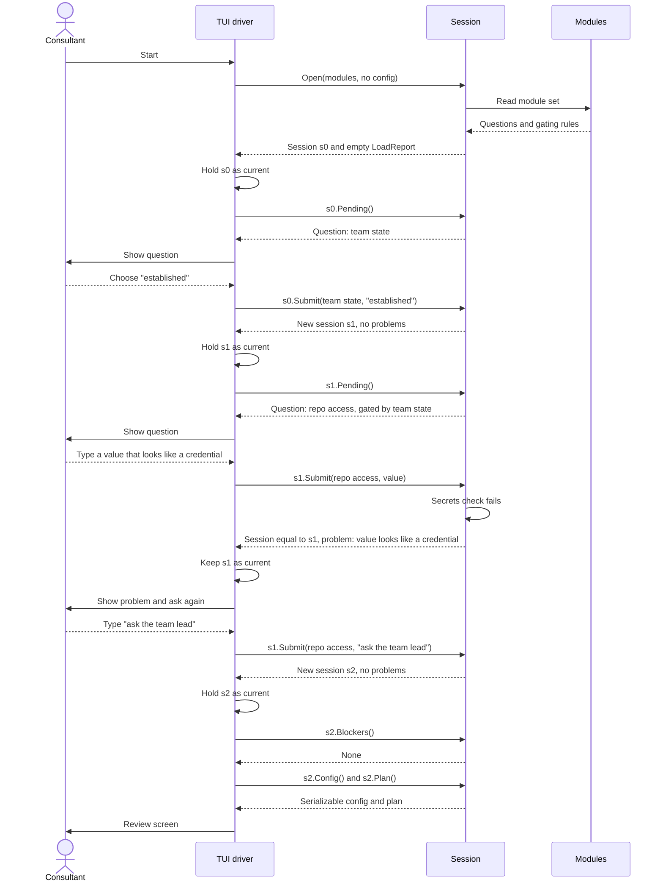

# 0010. Session engine

Status: proposed

Relates to [#24](https://github.com/8thlight-daveloper/onboard-kit/issues/24), [#6](https://github.com/8thlight-daveloper/onboard-kit/issues/6), [#23](https://github.com/8thlight-daveloper/onboard-kit/issues/23).

## Context

The walkthrough decides which questions to ask, validates answers, and builds the config. If that logic lives in the user interface layer, only that interface can exercise it. A headless `assemble` command tests only the last step, from a finished config to a document. Nothing tests how the config came to be: gating, validation, the secrets check, or regeneration from an older config.

We also want components that can be deleted and rebuilt, judged by independent tests. A component that cannot be driven without a terminal cannot be judged that way.

## Decision

Add a `session` package. A session is a pure state machine with no I/O.

- State is a function of two inputs: the module set and the ordered list of answers. Replaying the same answers always rebuilds the same state.
- Calls take and return plain serializable types. No terminal concerns such as prompts, defaults display, or styling.
- The session never reads or writes files. Drivers do.

Surface, as a sketch:

```go
s, report := session.Open(modules, config) // config optional; nil starts fresh
s.Pending()                             // active questions, in order
s2, problems := s.Submit(id, value)     // returns a new session and any problems
s.Blockers()                            // what still stops assembly
s.Config()                              // serializable, saved as <name>.obk.yaml
s.Plan()                                // input to the document assembler
```

### Sessions are immutable

`Submit` does not change the session it is called on. It returns a new session with the answer applied, plus any problems. If the answer has problems, it is not applied, and the returned session is equal to the original. Every other call is a read.

- **Undo is free.** The review screen's "go back" keeps earlier session values and returns to one. No replay or undo logic.
- **Tests can fork.** One test builds a session up to a shared prefix and tries many next answers from it, independently and in parallel.
- **No shared mutation.** A session value can be read from several goroutines without locks.
- **Same as replay.** State is already a function of modules and ordered answers, so each new session is the previous answers plus one.
- **Adapters hold the current value.** The stdio adapter and the TUI driver each keep a reference and replace it with the returned session after each `Submit`. The adapter's observable behavior is unchanged.

The cost is one small allocation per answer. Questions number in the tens, so this does not matter.

Four drivers share this one path:

| Driver | Input | Does |
| --- | --- | --- |
| TUI | Keystrokes | Shows `Pending()`, forwards input to `Submit`, shows problems |
| Headless assemble | A config file | Replays every answer through `Submit`, checks `Blockers()`, then assembles the document |
| Scripted session | JSON commands on stdin | Exposes the session calls over stdio for black-box tests |
| Contract test | Go calls | Drives the `session` package directly and asserts on `Config()` and `Plan()` |

Headless assemble is not a separate pipeline. It is a session with no human.

### Commands

Both are experimental until after the MVP, so scripts that depend on them carry no stability promise.

`assemble` is the deterministic step from answers and modules to a document. It matches the architecture principle "Deterministic assembly" and avoids confusion with drawing a terminal screen. The internal `render` component keeps its name, since it turns a plan into a document in an output style.

- `onboard-kit assemble --config <file>` assembles a document from a finished config. It replaces the earlier deferral of non-interactive document assembly. Acceptance tests use it to judge config in, document out.
- `onboard-kit session` runs one session over stdio. The process is the session, so there is no session ID. Acceptance tests use it to judge the whole app, including the question flow.

The stdio protocol is line-delimited JSON, one request per line and one response per line, in order. Sketch:

```
-> {"cmd":"pending"}
<- {"ok":true,"questions":[{"question":"team-state","kind":"choice","options":["established","first-consultants"]}]}
-> {"cmd":"submit","question":"team-state","value":"established"}
<- {"ok":true,"problems":[]}
-> {"cmd":"blockers"}
<- {"ok":true,"blockers":[]}
-> {"cmd":"config"}
<- {"ok":true,"config":{}}
-> {"cmd":"plan"}
<- {"ok":true,"plan":{}}
-> {"cmd":"nonsense"}
<- {"ok":false,"error":{"code":"unknown_command","message":"unknown command: nonsense"}}
```

The adapter holds no logic of its own. Each command maps to one session call, and each response is the call's serializable result. Each test starts its own process, so tests stay independent. No ports, sockets, or auth are involved.

### State and identity

- **Call and response.** Every call is synchronous and returns a result, like a request to an HTTP API. The session never waits for a human and never calls back into a driver. A driver that wants an answer asks the human, then calls `Submit`.
- **No session ID.** The session is an in-process value. `Open` returns it and the caller holds it. IDs would only appear if a `serve` wrapper is added later, and the wrapper would own them.
- **Where state lives.** In memory, inside that value, as the module set plus the ordered answers. Nothing is stored between runs.
- **What persists.** The config. It holds the answers and a reference to the module set it was made with (version and module identifiers). It does not hold module content.
- **Reloading.** `Open(modules, config)` needs the modules again. Drivers supply the modules embedded in the binary, so the user never respecifies them. The reference in the config is what lets `Open` detect drift and build a `LoadReport`.

### Behavior the session owns

- **Gating.** A module question can declare that it gates others. `Pending()` is computed from current answers, so replay handles it. Which questions gate is a data rule on modules, decided under #6.
- **Secrets.** The check runs in `Submit`. A value loaded from a config file passes through it, so config files are covered by construction.
- **Older module set.** `Open` replays old answers against the new modules and returns a `LoadReport`: answers whose questions no longer exist, new unanswered questions, and changed definitions. The session itself never refuses. It reports, and the driver applies policy. The interactive driver shows the report and asks. The headless driver exits 3 with the report and assembles nothing, unless given an explicit flag to accept the changes. Accepting drops the orphaned answers and leaves new questions unanswered, so any new required question still shows up in `Blockers()`. The mechanism is decided here. Whether to show a diff or refuse as the default policy stays open under #23.
- **Gaps.** Unanswered optional questions appear as gaps in `Plan()`.

### Errors and shutdown

Errors fall into five classes.

| Class | Example | Handling |
| --- | --- | --- |
| Problem | Secret-like value, unknown question id | Normal result, not a tool failure |
| Blocker | Required question unanswered | Normal result, stops assembly |
| Drift | Config from an older module set | Normal result in `LoadReport`, driver applies policy |
| Protocol or usage error | Bad JSON, unknown command, unreadable file | Tool error |
| Internal failure | Panic, bug | Tool error, non-zero exit |

`onboard-kit assemble` exit codes:

| Code | Meaning |
| --- | --- |
| 0 | Document assembled |
| 1 | Problems or blockers. JSON report on stdout, short summary on stderr |
| 2 | Usage error, or config unreadable or invalid |
| 3 | Drift refused. Report on stdout |
| 70 | Internal failure |

Assemble writes nothing on a non-zero exit. The writer runs only after every check passes, and writes to a temporary file then renames, so a crash cannot leave a half-written document.

`onboard-kit session`:

- Problems and blockers are `"ok":true` results with the lists filled in.
- A protocol error returns `"ok":false` with an error code, and the session stays alive so a script can recover.
- A panic is caught, written to stderr, and ends the process with exit 70.
- Stdout carries only protocol lines. Logs go to stderr.
- Closing stdin is the normal end signal. The process discards the session and exits 0. The session does no I/O of its own, so nothing is left behind.

### Acceptance test helper

Acceptance tests share one helper under `acceptance/`, so no test handles processes itself.

- **Assemble runs.** The helper runs the process and captures stdout, stderr, and the exit code. An expected failure is an assertion, for example exit 3 with a report listing dropped answers. An unexpected non-zero exit fails the test, with stderr and the report in the message.
- **Session runs.** The helper wraps the process as a client with `Send(cmd)` returning the parsed response. An `"ok":false` response fails the test unless the test opts in to expect it. If the process dies mid-test, `Send` fails with the exit code and captured stderr. Each `Send` has a read deadline, so a hung binary fails the test instead of stalling the run.
- **Shutdown.** The client registers `t.Cleanup` when it starts. Cleanup closes stdin, waits briefly for exit, and kills the process if it does not exit. `t.Fatal`, `t.FailNow`, and a panic in the test goroutine all run cleanup, so a failed assertion and a passing test shut down the same way.
- **Test crashes.** Cleanup does not run if the test binary is killed, for example by a `go test -timeout` expiry or `os.Exit`. The child then sees stdin close, which is the normal end signal, and exits on its own.
- **Goroutines.** Helpers that run in other goroutines report with `t.Error`, never `t.Fatal`, because `FailNow` is only valid on the test goroutine.

### Boundaries

- `session` uses the module selector to derive the question set, the plan instantiator for `Plan()`, and the secrets check in `Submit`. It imports only those and the domain model. See [0020](0020-binary-structure-and-regenerative-components.md) for the full layering.
- Drivers import `session`. The TUI imports nothing else from core. Drivers call the document assembler with the plan the session returns.
- `session` is a regenerable component. Its contract tests are scripted answers in, config and plan out.

## Sequence

### Contract test as the driver

The test calls the `session` package in-process. It judges one component and lives under `contracts/session/`.



### Acceptance test as the driver

The test starts the built binary and talks to it over stdio. It judges the whole app and lives under `acceptance/`. It sees only commands and responses, never the session package.



### Running app with a consultant



Assembling and writing happen after the review screen, outside the session. The TUI hands the plan to the document assembler and the config to the config store.

## Consequences

- The walkthrough logic is testable without a terminal. The gap in the headless-only approach closes.
- The TUI becomes a thin, replaceable driver. A second client, such as a web UI, adds a driver. The stdio adapter already proves the types serialize. A network server would be another thin wrapper over the same calls.
- Acceptance tests can exercise the question flow without a terminal, through the same binary consultants run.
- The stdio protocol is a second public surface beside `assemble`. It is experimental, but breaking it breaks acceptance tests, so changes to it need human approval like any other test change.
- Every question and rule lives in module data or the session. A UI that adds its own rules breaks the headless path, so reviews must reject UI-side logic.
- `Submit` must stay free of terminal concerns. This is the main way the design can erode.

## Alternatives considered

- **Logic inside the TUI, headless assemble only.** Cheapest now. Leaves the walkthrough logic untestable without a terminal.
- **A mutating session.** `Submit` changes the session in place. Simpler to write, but "go back" needs undo logic, tests cannot fork from a shared prefix, and concurrent reads need locks. Rejected.
- **Scanning for orphaned session processes at startup.** Rejected. A session holds no ports, locks, or files, and exits on stdin EOF, so orphans need a hung child, which is a bug. A scan cannot tell a stray from a parallel test run or a consultant's live session, so it risks killing the wrong process, and PID files add state to a stateless tool. If a stuck process is ever observed, add an opt-in `--max-lifetime` flag that the test helper sets just above the test timeout, or kill the process group from the helper.
- **A local server with the TUI as a client.** Gives independent clients and a permanent API contract. Costs process lifecycle, socket auth, and wire versioning for a single short-lived client. The stdio adapter above takes the useful part, a black-box protocol, without the network. Revisit a network server if a second concurrent client appears or hosting ([#4](https://github.com/8thlight-daveloper/onboard-kit/issues/4)) becomes real.

## Open questions

- Which questions are optional and which gate the rest ([#6](https://github.com/8thlight-daveloper/onboard-kit/issues/6))? The session supports either answer.
- Default policy for an older module set: show a diff or refuse ([#23](https://github.com/8thlight-daveloper/onboard-kit/issues/23))?
