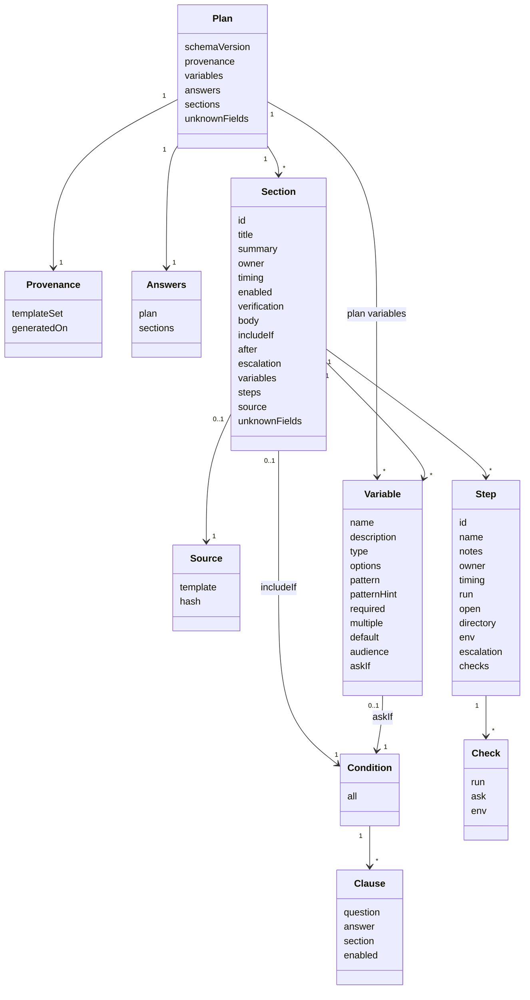

# Domain model

Status: proposed

The types that several components pass to each other. They live in one protected folder, import nothing from the project, and change only by ADR, because the stored types are the plan file format in memory. See [0020](../decisions/0020-binary-structure-and-regenerative-components.md) and [0030](../decisions/0030-self-contained-plan-file.md).

This page is language-neutral. A type here is a record with named fields. A field marked optional may be absent. The code layout for the current language is in [code layout](../stack/code-layout.md).

## Stored and computed

| Kind | Types | Lives in |
| -- | -- | -- |
| Stored | Plan, Provenance, Variable, Answers, Value, Section, Source, Variable, Condition, Clause, AnswerTest, Step, Check | The plan file |
| Computed | Question, Suggestion, Blocker, Problem | Returned by the finder, validator, and editor. Never saved |
| Output | Document | Returned by the document assembler. Transitional, see [0025](../decisions/0025-contracts-and-tests.md) |

Stored types are what the decoder reads and the encoder writes. Computed types are what drivers show and what acceptance scenarios assert on, so their serialized shape is part of the `stdio` protocol in [0010](../decisions/0010-plan-editor.md).

## Plan

| Field | Type | Notes |
| -- | -- | -- |
| `schemaVersion` | Integer | See [0030](../decisions/0030-self-contained-plan-file.md#versioning) |
| `provenance` | Provenance |  |
| `variables` | List of Variable | Plan variables: the axis variables, document details, and settings |
| `answers` | Answers | Every answer, by scope |
| `sections` | List of Section | Every template, as a section |
| `unknownFields` | Map of unknown fields | Fields the tool does not know. Kept on load and written back, so a plan from a newer tool survives an older one |

A Plan is a value. No function changes one, and an edit returns a new Plan. A Section in a plan and a section template are the same type. A template is a Section with no `source`. The file's `schemaVersion` belongs to the decoder and the migrator, not to the Section.

## Provenance

| Field | Type | Notes |
| -- | -- | -- |
| `templateSet` | Text | The build's commit sha or tag |
| `generatedOn` | Date | Text in ISO form, such as `2026-10-15`. A driver passes it in, because the core never reads a clock |

## Answers and Value

`answers` holds the answers, by scope.

| Field | Type | Notes |
| -- | -- | -- |
| `plan` | Map of name to Value | Answers to plan variables |
| `sections` | Map of section id to a map of name to Value | Each section's own answers |

A Value is one of:

| Variant | Holds | Written as |
| -- | -- | -- |
| Text | Text | A string |
| Flag | Boolean | `true` or `false`, lowercase |
| List | List of text | A list. Used by `command` variables and `multiple` variables |
| Deferred | Nothing | The literal `deferred`, accepted for every type. The person chose to answer later |

A Value is a settled answer unless it is Deferred or empty. See [conditions](section-template-schema/conditions.md).

## Section

| Field | Type | Notes |
| -- | -- | -- |
| `id` | Text | A lowercase slug. Never `plan` |
| `title`, `summary` | Text | The only required fields besides `id`. Blank text counts as missing, see [0040](../decisions/0040-blank-text-and-variable-name-length.md) |
| `owner` | Text, optional | May contain `$name` |
| `timing` | Timing, optional | Defaults to `anytime` |
| `enabled` | Boolean, optional | True by default. Only a plan section has it, and a person turns a section off. See [0050](../decisions/0050-section-switch.md) |
| `verification`, `body` | Text, optional | Markdown prose |
| `includeIf` | Condition, optional | Names plan variables only |
| `after` | List of section ids, optional |  |
| `escalation` | List of variable names, optional | Who to ask when the section is blocked. Names of `person` variables the section declares. See [escalation](section-template-schema/escalation.md) |
| `variables` | List of Variable, optional |  |
| `steps` | List of Step, optional |  |
| `source` | Source, optional | Absent on a template and on a section added by hand |
| `unknownFields` | Map of unknown fields | Kept in a plan, rejected in a template |

## Source

| Field | Type | Notes |
| -- | -- | -- |
| `template` | Text | The template id |
| `hash` | Text | The content hash from the section hasher, computed over everything except `source` |

## Variable

| Field | Type | Notes |
| -- | -- | -- |
| `name` | Text | `[a-z][a-z0-9_]{2,}`, not reserved. See [0040](../decisions/0040-blank-text-and-variable-name-length.md) |
| `description` | Text |  |
| `type` | VariableType | `string` by default |
| `options` | List of text, optional | For a `choice` |
| `pattern`, `patternHint` | Text, optional | RE2 syntax, for a `string` |
| `required` | Boolean, optional |  |
| `multiple` | Boolean, optional | Takes several answers, held as a list. Only `person` allows it for now |
| `default` | Value, optional | Must satisfy the type, options, and pattern |
| `audience` | Audience, optional | `onboarder` by default |
| `askIf` | Condition, optional |  |

## Condition, Clause, and AnswerTest

| Type | Field | Notes |
| -- | -- | -- |
| Condition | `all` | List of Clause. Every clause must hold |
| Clause | `question` | A question id. A bare name means the same section |
| Clause | `answer` | An AnswerTest. A clause with `question` has `answer` |
| Clause | `section` | A section id. A clause with `section` tests that section's switch, and has `enabled` and no `question` |
| Clause | `enabled` | Boolean. The clause holds when the named section's switch equals it |
| AnswerTest | `is`, `isNot` | One Value |
| AnswerTest | `isOneOf`, `isNotOneOf` | A list of two or more Values |
| AnswerTest | `isSettled` | Boolean |

Several tests in one AnswerTest must all hold. A section uses a Condition only through `includeIf`, and a variable only through `askIf`.

## Step and Check

| Field | Type | Notes |
| -- | -- | -- |
| `id`, `name` | Text |  |
| `notes` | Text, optional | Markdown prose |
| `owner` | Text, optional |  |
| `timing` | Timing, optional | Inherited from the section |
| `run` | List of text, optional | Each item may contain `$name`, or one `$name` that expands to a list |
| `open` | Text, optional | A URL or file |
| `directory` | Text, optional |  |
| `env` | Map of name to text, optional | Names are uppercase letters, digits, and underscores |
| `escalation` | List of variable names, optional | Who to ask when the step is blocked. Inherits the section's when absent |
| `checks` | List of Check, optional |  |

A Check has exactly one of `run` (a list of text), `ask` (text, a yes or no question), or `env` (a variable name). The meaning of each is in [steps](section-template-schema/steps.md).

## Enumerations

| Name | Values |
| -- | -- |
| VariableType | `string`, `boolean`, `choice`, `command`, `person` |
| Audience | `onboarder`, `onboardee` |
| Timing | `before-day-one`, `week-one`, `days-8-to-30`, `days-31-to-90`, `anytime`. Each has a fixed day window, see [ordering](section-template-schema/ordering.md#timing) |
| Severity | `error`, `warning` |

## Computed types

### Question

What the finder returns for one active question.

| Field | Type | Notes |
| -- | -- | -- |
| `id` | Text | `<scope>.<name>`, such as `access.repo_url` |
| `scope` | Text | `plan` or a section id |
| `name` | Text |  |
| `description` | Text |  |
| `type` | VariableType |  |
| `options` | List of text, optional |  |
| `required` | Boolean |  |
| `multiple` | Boolean |  |
| `audience` | Audience |  |
| `answer` | Value, optional | The stored answer, if any |
| `declaredDefault` | Value, optional | The variable's `default`, shown to the person. Not a stored answer |
| `group` | Text | The key shared by questions with the same name, type, options, and `multiple` |
| `suggestions` | List of Suggestion |  |

### Suggestion

A group is the set of questions that share a `group` key, so a user interface can ask them once. It has no type of its own. A Suggestion is a Value offered for a question, with where it came from: a declared default, or an answer already given in the plan or a section.

| Field | Type | Notes |
| -- | -- | -- |
| `value` | Value |  |
| `source` | `default` or `given` |  |

### Blocker

| Field | Type | Notes |
| -- | -- | -- |
| `question` | Text | The id of an active, required planning question with no answer |

### Problem

A report about a plan or one value. It is a normal result, not a failure. A warning is advice, such as a role with only one person.

| Field | Type | Notes |
| -- | -- | -- |
| `code` | Text | A stable machine name, defined by the contract of the component that reports it |
| `severity` | Severity | An `error` stops an answer from being applied and blocks assembly. A `warning` is shown and never blocks |
| `message` | Text | For people |
| `question` | Text, optional | The question id, when one applies |
| `section` | Text, optional | The section id, when one applies |
| `detail` | Map of text to text, optional | Extra facts, such as the two sections in a timing conflict |

## Open questions

- Which problem codes exist? The contracts of the validators and the editor define them, and this page lists them once they exist.
