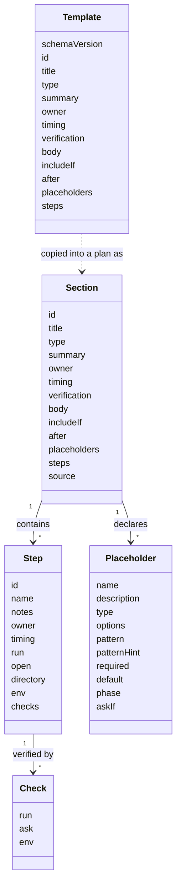

# Section template schema

Status: accepted. A worked example lives in [examples/acme](../examples/acme/README.md).

A section template, often shortened to template, is one YAML file at `templates/<id>.yaml`. A plan holds every standard template as a section, copied unchanged with one added field, `source`. So a template and a section have the same shape, and a template file is a section before it is in a plan. The domain model has one Section type. A template is a Section with no `source`, and the file's `schemaVersion` belongs to the loader and the migrator. Which sections are active is computed from the plan's answers whenever it is needed, and placeholders stay in place until the document is assembled. See [0030](../../decisions/0030-self-contained-plan-file.md).

## Parts

| Doc | Covers |
| -- | -- |
| This page | The section fields, selection, and the format rules |
| [placeholders.md](placeholders.md) | The `$name` syntax, dollar signs, `unknown-yet`, fields, types, and phase |
| [conditions.md](conditions.md) | `askIf` and `includeIf`: when a question is asked and when a section is included |
| [optional-sections.md](optional-sections.md) | The `enabled` toggle |
| [ordering.md](ordering.md) | `timing`, `after`, the computed order, and the checks on dependencies |
| [steps.md](steps.md) | Steps, `checks`, and environment variables |
| [reserved-names.md](reserved-names.md) | Names a template may not use |

## Section fields

| Field | Purpose |
| -- | -- |
| `id`, `title`, `type`, `summary` | The only required fields. Everything else is optional |
| `includeIf` | A [condition](conditions.md) on plan-level answers, such as the discipline. No `includeIf` means always included |
| `timing` | When the work happens, from a closed ordered set. See [ordering](ordering.md) |
| `after` | Ids of sections that must come before this one. See [ordering](ordering.md) |
| `owner`, `verification`, `body` | Who acts, how to tell it worked, and Markdown prose |
| `placeholders` | Values the section needs. Each becomes a question. See [placeholders](placeholders.md) |
| `steps` | Optional steps. See [steps](steps.md) |
| `source` | Plan only. The template id and a content hash recorded when the template was copied. See 0030 |
| `schemaVersion` | Template files only. Plans carry one at the top |

## Selection

- A section is active when its `includeIf` condition holds, or it has none, and its `enabled` answer, or default, is true. A section with no `enabled` placeholder is always on. See [optional sections](optional-sections.md).
- Active sections sort by `timing`, then `after`, then `id`. See [ordering](ordering.md).
- Core templates have no `includeIf`. A variant has one that narrows by an axis, and never overrides a core template. See [conditions](conditions.md#section-conditions).

## Format rules

- Prose fields, `body` and `notes`, hold Markdown in literal blocks, hard-wrapped.
- One JSON Schema covers templates and plans, so editors can validate and complete them.
- Templates decode strictly and reject unknown fields. Plans decode leniently and keep unknown fields, so a plan written by a newer tool survives an older one.
- Everything beyond `id`, `title`, `type`, and `summary` is optional, so the schema can grow without breaking older files.
- Booleans are lowercase `true` and `false` only. Unquoted `yes`, `no`, `on`, `off`, and similar are errors, and so are anchors and aliases. See the Format section of 0030.

## Decided against, for now

| Idea | Decision | Why |
| -- | -- | -- |
| A variant that overrides or extends a core template | No. A variant is a template with its own `includeIf`. See [conditions](conditions.md#section-conditions) | Plans hold every template with no merging. Twins with opposite conditions cover the need |
| A `reviewedOn` date that drives a staleness warning | No | The value is unclear, and nothing needs it. Revisit if stale content becomes a real problem |
| An `if:` on steps for per-platform commands | No | Almost every plan targets one operating system. Where a plan needs two, write twin steps, or twin templates with an `includeIf`. A step condition would reuse the condition syntax |
